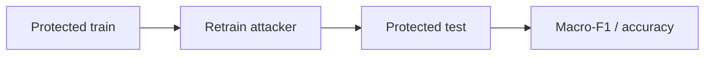
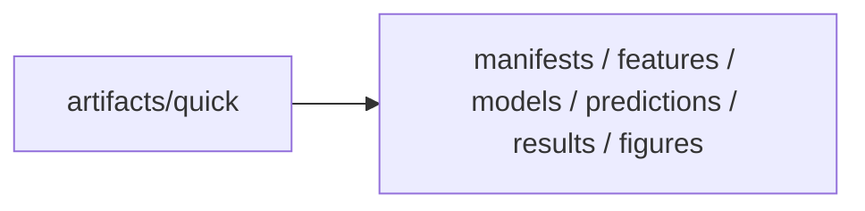
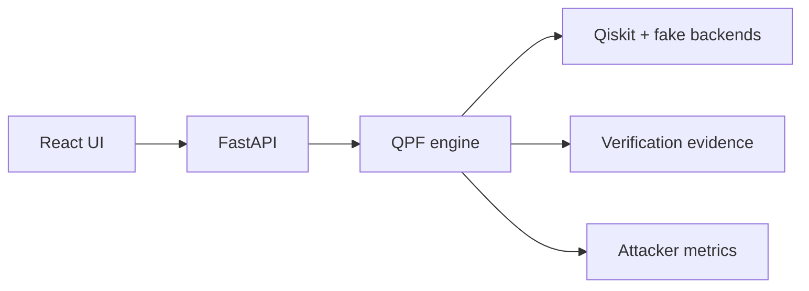
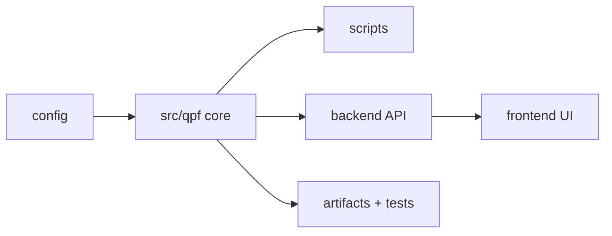

# Quantum Privacy Firewall

[](https://www.python.org/)
[](https://www.ibm.com/quantum/qiskit)
[](https://fastapi.tiangolo.com/)
[](https://react.dev/)
[](https://scikit-learn.org/)

**A privacy-aware compilation firewall for detecting and reducing algorithmic-intent leakage from transpiled quantum circuits.**

Built for **Q-Hack India 2026: Quantum Security & Cryptography track**.

Quantum Privacy Firewall (QPF) sits between a developer's logical quantum program and the circuit submitted to a quantum backend. It audits structural intent leakage, searches for functionally equivalent circuit representations with less revealing compiled fingerprints, verifies correctness, constrains hardware overhead, and tests the resulting protection against adaptive machine-learning attackers.

> IBM Research showed that transpiled quantum circuits can retain enough structural information to reveal coarse algorithmic intent. QPF explores the defensive question: how can we reduce that leakage before the circuit leaves the developer's environment?

---

## The Problem

Quantum programs do not execute on hardware in the high-level logical form in which they are designed.
Before execution, a quantum circuit undergoes **backend-aware transpilation**: logical operations are decomposed into the processor's native gate set, logical qubits are mapped onto physical qubits, routing operations are introduced to satisfy the hardware **coupling topology**, and gate sequences are optimized for the target backend.

This transformation creates an overlooked **privacy surface**. Although transpilation significantly rewrites the original program, the resulting physical circuit can retain measurable structural fingerprints of the underlying computation.

Recent work by **Beat Buesser and Anil Kurmus, IBM Research** demonstrates that an observer with access only to the final backend-transpiled circuit can use normalized structural features to infer its **coarse algorithmic intent**, without access to the source program, logical-qubit layout, routing history, or intermediate compiler states.
This creates a security problem for quantum cloud computing:

> Protecting the source code does not necessarily protect the intent of the computation: the backend-visible circuit itself can become an information-leakage channel.

Observable properties such as **gate composition, temporal two-qubit activity, physical-qubit load distribution, coupling-edge utilization, and interaction concentration** can form an algorithm-specific structural fingerprint. For proprietary quantum workloads, this may expose whether a private computation resembles search, optimization, Fourier-style processing, or entanglement generation.

**QPF addresses the defensive problem:**

> **Can we build a privacy-aware compilation layer that measures and reduces algorithmic-intent leakage from backend-transpiled quantum circuits, while preserving quantum semantics and bounding the additional hardware cost?**
---

## What QPF Does


A protected candidate must:

1. remain functionally equivalent to the original circuit;
2. compile successfully for the target backend;
3. produce an observable changed physical circuit;
4. remain within configured execution-cost limits; and
5. be evaluated against attackers that are allowed to learn the defense.

---

## Core Pipeline

### 1. Generate Quantum Workloads

QPF generates deterministic Qiskit circuits from four protected algorithm families. Each generator is pure in `(family, width, seed)`, so experiments can be reproduced exactly across dataset builds and defense runs.

| Family | Representative workload |
| --- | --- |
| `qft` | Quantum Fourier Transform |
| `grover` | Grover-style search / amplitude amplification |
| `qaoa` | QAOA optimization circuits |
| `graph_ghz` | Graph-state and GHZ entanglement |

A separate `random` family is used as a control.

Each circuit is reproducibly generated from:

```text
(family, width, seed)
```

Implementation: [`src/qpf/circuits.py`](src/qpf/circuits.py)

---

### 2. Hardware-Aware Transpilation

Circuits are compiled with Qiskit against hardware-like IBM fake backend targets.

The research pipeline primarily uses:

```text
FakeNighthawk
```

The interactive demo additionally supports:

```text
FakeSherbrooke
FakeBrisbane
```

Transpilation exposes the classes of artifacts relevant to the threat model: native gate decomposition, physical-qubit mapping, routing, optimization-level behavior, coupling-map pressure, active-wire usage, and backend-edge activity.

Implementation: [`src/qpf/compilation.py`](src/qpf/compilation.py)

---

### 3. Extract the Structural Fingerprint

The attacker does not receive the original source program.

It observes structural information derived from the **final physical circuit**.

QPF extracts 13 normalized features spanning three leakage surfaces. The feature vector is intentionally compact and interpretable so that classification results can be traced back to concrete physical-circuit properties rather than opaque learned embeddings.

**Gate composition**
- two-qubit gate fraction
- `rz`, `sx`, and `x` fractions

**Temporal structure**
- mean two-qubit activity per layer
- two-qubit burstiness
- early / middle / late two-qubit activity

**Spatial hardware structure**
- active physical-qubit fraction
- qubit-load Gini coefficient
- edge entropy
- maximum hardware-edge load share

The analyzer separately records depth, total operations, two-qubit gate count, and active physical qubits for controls, cost accounting, candidate rejection, and metadata-only baseline evaluation.

Implementation: [`src/qpf/features.py`](src/qpf/features.py)

---

### 4. Attack the Circuit

QPF deliberately attacks its own compiled workloads to quantify intent leakage under controlled, source-disjoint train/test splits.

Implemented adversaries include:

- **Random Forest** — primary attacker
- **Logistic Regression**
- **Gradient Boosting**
- **Normalization-aware Random Forest** — stress attacker

The primary classification task is:


The benchmark also includes shuffled-label and metadata-only controls, so the pipeline can distinguish real structural signal from trivial size/depth confounds.

Implementation: [`src/qpf/attacks.py`](src/qpf/attacks.py)

---

## The Privacy Firewall

Detecting leakage is only the first half of QPF.

Once a circuit's physical representation has been analyzed, the firewall searches for alternative representations of the same computation. The goal is not simply to make the circuit larger or visually busier; every candidate must survive compilation, verification, and budget checks.

### Equivalent Decomposition

Quantum operations can often be represented through equivalent gate sequences.

QPF rewrites selected operations into alternative decompositions, changing the observable gate-level representation while preserving circuit semantics. Implemented rules include alternatives for operations such as `cx`, `cz`, `h`, `x`, `rx`, `swap`, `cp`, and `rzz`.

### Dependency-Preserving Reordering

Independent operations can sometimes be reordered without changing the computation.

QPF generates alternative schedules while preserving qubit dependencies rather than arbitrarily shuffling gates.

### Layout Diversification

Different valid logical-to-physical qubit mappings can change routing, edge usage, physical-qubit activity, and the resulting structural fingerprint.

QPF searches connected physical layouts on the target backend, which can alter routing, qubit-load distribution, edge concentration, and active hardware footprint.

Strategies can also be combined:

```text
decomp
reorder
layout
decomp + reorder
decomp + layout
reorder + layout
decomp + reorder + layout
```

Implementation: [`src/qpf/defenses.py`](src/qpf/defenses.py)

---

## Correctness Before Privacy

A circuit that hides its intent but computes the wrong function is not a valid defense.

Every candidate therefore passes through **quantum equivalence verification**.

QPF uses:

- Qiskit `Operator.equiv` where exact operator comparison is feasible;
- MQT QCEC when configured for scalable circuit equivalence checking;
- layout-aware compiled-circuit verification in the web workflow, including initial/final layouts and clean ancilla behavior for small active circuits.

Verification has three states:

```text
PASS
FAIL
UNKNOWN
```

Only `PASS` candidates can be selected. `FAIL` and `UNKNOWN` candidates are retained as evidence with rejection reasons, but they cannot become the selected protected circuit.

Implementation: [`src/qpf/verification.py`](src/qpf/verification.py)

---

## Privacy Has a Cost

Adding arbitrary operations could obscure structure while making the circuit unusable.

QPF therefore constrains candidate circuits using explicit hardware-cost budgets:

- relative circuit-depth overhead;
- relative two-qubit gate overhead;
- relative active-physical-qubit overhead.

Conceptually, the firewall searches for:

\[
\min_{C'} \; Leakage(C')
\]

subject to

\[
C' \equiv C
\]

and

\[
Cost(C') \leq Budget
\]

where \(C\) is the original circuit and \(C'\) is a candidate protected representation.

Candidates that fail verification, fail compilation, exceed the configured budget, or compile back to an unchanged physical circuit are rejected.

Implementation: [`src/qpf/selection.py`](src/qpf/selection.py)

---

## Adaptive Attacker Evaluation

A defense should not be considered successful merely because it confuses a classifier trained only on undefended circuits.

QPF assumes a stronger adversary:

> **The attacker knows that the defense exists and can train on protected circuits.**

For every evaluated resource budget:



This distinguishes genuine robustness from simple distribution shift.

QPF evaluates adaptive Random Forest, Logistic Regression, Gradient Boosting, and normalization-aware attacks. This gives a stronger read than a static before/after confidence drop because the protected distribution is part of the adversary's training data.

---

## Experimental Validity

The pipeline includes several controls intended to prevent misleading security results.

### Source-Disjoint Splitting

All compiled variants originating from the same logical circuit share a `base_id`.

Train, validation, and test partitions are grouped by this identifier, preventing different transpiled versions of the same logical circuit from leaking across the train/test boundary.

### Label-Free Defense Selection

Held-out true labels are never used to choose protected candidates.

### Adaptive Evaluation

Attackers are retrained on protected training circuits before being evaluated on protected held-out circuits.

### Traceable Results

Reported benchmark metrics are backed by saved prediction files, manifests, experiment configuration, and frozen test identifiers.

---

## Results

The committed **quick-profile benchmark** provides a reproducible proof of concept.

### Baseline Intent Leakage

| Evaluation | Macro-F1 |
| --- | ---: |
| Full-feature Random Forest | **0.937** |
| Shuffled-label control | 0.409 |
| Metadata-only control | 0.874 |
| Random chance | 0.250 |

The experiment demonstrates that algorithm family is learnable in the controlled benchmark.

It also exposes an important limitation: the metadata-only classifier reaches **0.874 macro-F1**, indicating that circuit complexity metadata remains a significant confound.

QPF reports this explicitly rather than attributing all classification performance to deeper structural leakage. This is important because a privacy firewall should reveal when a dataset or benchmark still leaks through simple resource metadata.

### Adaptive Defense Evaluation

| Budget | Adaptive RF | Logistic Regression | Gradient Boosting | Normalization-Aware |
| ---: | ---: | ---: | ---: | ---: |
| 0% | 0.937 | 0.817 | 0.937 | 0.782 |
| 10% | 0.874 | 0.874 | 0.806 | 0.718 |
| 20% | 1.000 | 0.816 | 0.813 | 0.879 |
| 50% | **0.626** | 0.679 | **0.441** | 0.873 |

The results are intentionally not presented as proof of universal privacy.

They show that:

- measurable intent leakage exists in the controlled benchmark;
- equivalent circuit transformations can change attacker performance;
- privacy improvement is **attacker- and budget-dependent**;
- an adaptive or normalization-aware attacker can recover information that defeats weaker evaluations;
- meaningful circuit privacy therefore requires adversarial evaluation, not merely visually different circuits.

The current contribution is a **working, reproducible framework for measuring and reducing leakage under explicit correctness and execution-cost constraints**.

Saved evidence:



---

## Interactive Circuit Lab

QPF includes a React + FastAPI web application for running the firewall on individual circuits.

A user can configure:

- algorithm family;
- circuit width and seed;
- target backend;
- transpiler optimization level and seed;
- number of candidate variants;
- transformation strategies;
- execution-overhead budget.

The application then displays:

- logical input circuit;
- baseline transpiled circuit;
- selected protected candidate;
- verification evidence;
- candidate rejection reasons;
- structural metrics;
- depth and two-qubit overhead;
- attacker prediction;
- saved benchmark results;
- archived benchmark metrics from the saved quick-profile experiment;
- OpenQASM 3 and JSON evidence exports.



---

## Repository Structure



---

## Quick Start

### Requirements

- Python 3.10+
- Node.js 22.12+
- Git

### Install

```bash
git clone https://github.com/Usainbond007/qpf.git
cd qpf

python3 -m venv .venv
source .venv/bin/activate

python -m pip install --upgrade pip
python -m pip install -r requirements.txt
python -m pip install -e .
```

### Run the Research Pipeline

Smoke test:

```bash
python scripts/reproduce_all.py --profile smoke
```

Reproduce the committed quick-profile experiment:

```bash
python scripts/reproduce_all.py --profile quick
```

### Run the Web Application

Backend:

```bash
python -m uvicorn backend.app.main:app --host 127.0.0.1 --port 8000
```

Frontend:

```bash
cd frontend
npm ci
npm run dev
```

Open:

```text
http://localhost:5173
```

---

## Testing

Run the Python test suite:

```bash
pytest -q
```

Run frontend tests:

```bash
cd frontend
npm test
```

Build the frontend:

```bash
npm run build
```

Tests cover split disjointness, deterministic feature extraction, equivalence verification, invalid-circuit rejection, budget boundaries, label-free candidate selection, API behavior, compiled-circuit verification, benchmark traceability, and frontend interactions.

---

## Research Basis

QPF was motivated by:

**Beat Buesser and Anil Kurmus, IBM Research**  
*Algorithmic Intent Leakage in Transpiled Quantum Circuits: An Initial Reverse-Engineering Study*, IEEE Quantum Week 2026.

Their work demonstrates that final backend-transpiled quantum circuits can leak coarse algorithmic intent through observable structural features. 

Our work builds a privacy-aware compilation firewall that detects this leakage and evaluates verified, functionally equivalent circuit transformations to reduce intent recoverability under adaptive attacks.

This repository is an **independent implementation**, not IBM Research source code or an official IBM project.

---

## Scope and Current Limitations

QPF is a research prototype for empirical quantum-circuit privacy evaluation.
Current research directions include:

- reducing metadata confounds through better-balanced workloads;
- feature-importance and leakage-channel ablation studies;
- cross-backend generalization;
- stronger adaptive and canonicalization-aware attackers;
- compiler-resistant circuit transformations;
- noisy-simulator and hardware evaluation.
