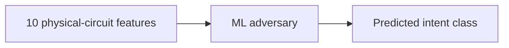
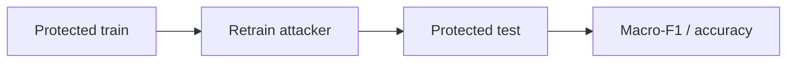
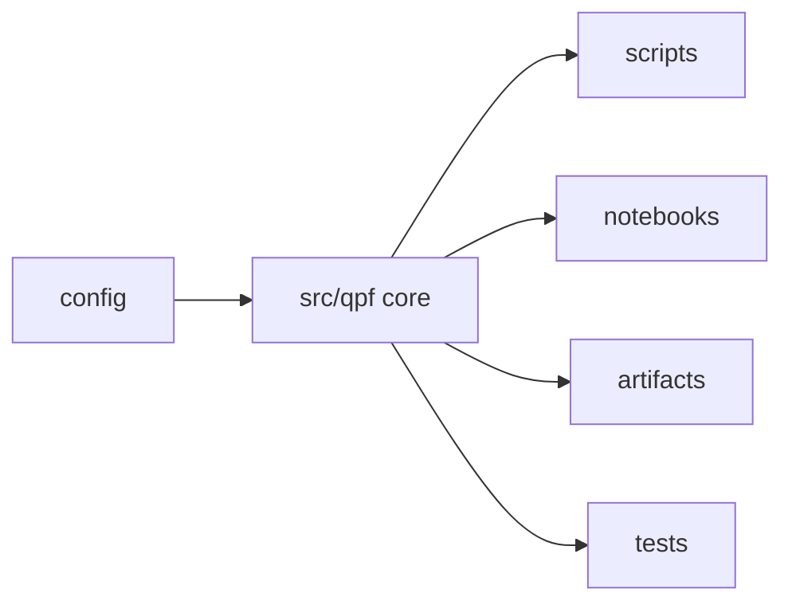

# Quantum Privacy Firewall

[](https://www.python.org/)
[](https://www.ibm.com/quantum/qiskit)
[](https://scikit-learn.org/)
[](https://jupyter.org/)

**A privacy-aware compilation firewall for detecting and reducing algorithmic-intent leakage from transpiled quantum circuits.**

Built for **Q-Hack India 2026: Quantum Security & Cryptography Track**.

## The Problem

Quantum cloud computing introduces an emerging **program-privacy attack surface**:
protecting a quantum algorithm's source code does not necessarily protect its
computational intent.

Before execution, quantum circuits are **transpiled** into hardware-compatible
physical circuits through native-gate decomposition, physical-qubit mapping,
routing, and backend-aware optimization. This process can preserve identifiable
structural fingerprints in **gate composition, two-qubit interaction patterns,
qubit utilization, circuit depth, and coupling-edge load**.

Recent research by Beat Buesser and Anil Kurmus, IBM Research demonstrates that
an observer can exploit these fingerprints to infer the **coarse algorithmic
intent** of a workload from its final transpiled circuit alone, without access
to the source program or intermediate compiler state.

> **The backend-visible circuit itself becomes an information-leakage channel for proprietary quantum workloads.**

## Our Solution

**Quantum Privacy Firewall (QPF)** introduces a **pre-submission,
privacy-aware compilation layer** between the developer and the quantum backend.

QPF **audits structural intent leakage**, generates alternative circuit
representations through **semantics-preserving transformations**, verifies
**quantum equivalence**, enforces **hardware-overhead budgets**, and evaluates
whether the resulting protection survives **adaptive machine-learning attackers
retrained on protected circuits**.

> **Goal: reduce the recoverability of algorithmic intent before a quantum circuit leaves the developer's environment, without changing what it computes or making it impractical to execute.**

---

## What QPF Does


A protected candidate must be equivalent to the original circuit, compile on the
target backend, create an observable changed physical circuit, remain within
overhead limits, and survive evaluation against attackers trained on protected
circuits.

---

## Core Pipeline

### 1. Generate Quantum Workloads

QPF deterministically generates Qiskit circuits for a paper-aligned benchmark:
47 generators across 7 high-level intent classes.

| Intent class | Representative workloads |
| --- | --- |
| entanglement generation | `ghz`, `graph_line`, `cluster_grid` |
| Fourier-like | `qft_swaps`, `qft_no_swaps`, `phase_estimation` |
| phase/oracle-like | `parity`, `phase_oracle`, `diagonal_phase_pattern` |
| amplitude amplification | `grover`, `grover_two_iterations`, `amplitude_estimation_style` |
| variational ansatz | `hea_linear`, `qaoa_line`, `qaoa_ring` |
| Hamiltonian simulation | `trotter_tfim`, `trotter_xxz`, `trotter_heisenberg` |
| arithmetic/permutation | `ripple_adder`, `incrementer`, `toffoli` |

Implementation: [`src/qpf/paper_circuits.py`](src/qpf/paper_circuits.py)

### 2. Hardware-Aware Transpilation

Circuits are compiled with Qiskit against `FakeNighthawk`. Transpilation exposes
the artifacts relevant to leakage: native gate decomposition, physical-qubit
mapping, routing, optimization-level behavior, coupling-map pressure,
active-wire usage, and backend-edge activity.

Implementation: [`src/qpf/compilation.py`](src/qpf/compilation.py)

### 3. Extract the Structural Fingerprint

QPF extracts 10 paper-aligned physical-circuit features from the final
transpiled circuit:

- two-qubit gate fraction,
- phase-rotation fraction,
- single-qubit gate entropy,
- two-qubit layer fraction,
- mean two-qubit operations per layer,
- layer two-qubit Gini,
- used hardware-edge fraction,
- edge two-qubit Gini,
- max edge-load fraction,
- qubit two-qubit Gini.

It also records depth, total operations, two-qubit count, and active physical
qubits for overhead accounting and metadata controls.

Implementation:
[`src/qpf/paper_features.py`](src/qpf/paper_features.py),
[`src/qpf/paper_benchmark.py`](src/qpf/paper_benchmark.py)

### 4. Attack the Circuit

QPF trains attackers on final-circuit features under source-disjoint train/test
splits.



Attackers include Random Forest, Logistic Regression, Gradient Boosting, a
normalization-aware Random Forest, shuffled-label controls, and metadata-only
controls.

Implementation:
[`src/qpf/paper_benchmark.py`](src/qpf/paper_benchmark.py),
[`src/qpf/paper_defense.py`](src/qpf/paper_defense.py)

---

## The Privacy Firewall

After auditing leakage, QPF searches for alternative representations of the same
computation.

| Strategy | What it changes |
| --- | --- |
| `decomp` | Equivalent gate decompositions |
| `reorder` | Independent operation order while preserving dependencies |
| `layout` | Logical-to-physical placement on connected backend qubits |
| `seed` | Transpiler-seed diversification |
| combinations | `decomp+reorder`, `decomp+layout`, `reorder+layout`, etc. |

Implementation: [`src/qpf/defenses.py`](src/qpf/defenses.py)

---

## Correctness and Cost

Every candidate is verified before selection. QPF uses Qiskit equivalence
checks, MQT QCEC when available, and DAG-identity checks.

```text
PASS / FAIL / UNKNOWN
```

Only `PASS` candidates can be selected. Candidates are also filtered by relative
depth overhead, two-qubit gate overhead, and active-physical-qubit overhead.

Candidates that fail verification, fail compilation, exceed budget, or compile
back to an unchanged physical circuit are rejected.

Implementation:
[`src/qpf/verification.py`](src/qpf/verification.py),
[`src/qpf/selection.py`](src/qpf/selection.py)

Final paper-full defense verification evidence:

| Verification method | Count |
| --- | ---: |
| MQT QCEC | 846 |
| DAG identity | 564 |
| Identical logical circuit | 564 |

All **1974** generated defense candidates passed logical-equivalence
verification in the final defense run.

---

## Adaptive Evaluation

QPF evaluates a stronger attacker that knows the defense exists and can train
on protected circuits.



This separates actual robustness from simple distribution shift.

Implementation: [`src/qpf/paper_defense.py`](src/qpf/paper_defense.py)

---

## Experimental Validity

- **Source-disjoint split**: all variants of a logical source circuit stay in
  one partition, preventing train/test leakage.
- **Label-free selection**: held-out labels are never used to choose protected
  candidates.
- **Adaptive evaluation**: attackers are retrained on protected training
  circuits.
- **Controls**: chance, shuffled-label, metadata-only, and generator-disjoint
  checks.
- **Traceable results**: metrics are backed by saved datasets, predictions,
  configs, and release artifacts.

---

## Results

The committed final benchmark uses:

- 47 generators,
- 7 intent classes,
- 6 variants per generator,
- 24 and 48 qubits,
- FakeNighthawk,
- optimization levels 0-3,
- 2256 transpiled circuits,
- 10 physical-circuit features.

### Baseline Intent Leakage

| Evaluation | QPF result |
| --- | --- |
| Within optimization level | 0.93-0.99 accuracy |
| Cross level except 2 <-> 3 | 0.22-0.52 accuracy |
| Level 2 -> 3 / 3 -> 2 | 0.906 / 0.912 |
| Within size 24 / 48 | 0.935 / 0.960 |
| 24 -> 48 / 48 -> 24 | 0.634 / 0.250 |
| Joint 24+48 -> 24 / 48 | 0.953 / 0.960 |

The baseline classifier recovers intent well above chance in matched regimes.
The metadata-only control is also strong, showing that resource metadata is part
of the leakage channel.

### Adaptive Defense Evaluation

Unprotected adaptive RF baseline: **0.916 +/- 0.007 macro-F1**. Chance for the
7-class task is **0.143**.

| Budget | Guided adaptive RF | Random eligible RF | Paired 95% CI of guided drop | Guided overhead |
| ---: | ---: | ---: | --- | --- |
| 0% | 0.904 | 0.914 | [-0.006, +0.030] | -2.3% depth / -2.8% 2Q |
| 10% | 0.879 | 0.900 | [+0.017, +0.058] | -2.1% depth / -2.9% 2Q |
| 20% | 0.878 | 0.887 | [+0.017, +0.059] | -0.6% depth / -1.9% 2Q |
| 50% | **0.865** | 0.883 | [+0.029, +0.073] | +5.5% depth / +3.5% 2Q |

These results show that equivalent transformations can reduce attacker
performance, but privacy improvement is attacker- and budget-dependent. QPF's
main contribution is the reproducible framework: leakage audit, verified
transformations, cost filtering, and adaptive evaluation.

---

## Notebook Demo

The Jupyter notebook is the primary visual demo surface.

```bash
jupyter lab notebooks/demo.ipynb
```

It shows:

- dataset split tables,
- baseline leakage metrics,
- verification evidence,
- candidate budget tables,
- adaptive defense tables,
- demo attack output,
- confidence plots,
- candidate plots,
- Qiskit circuit drawings when the local renderer is available.

Notebook: [`notebooks/demo.ipynb`](notebooks/demo.ipynb)

---

## Repository Structure



| Path | Purpose |
| --- | --- |
| `config/` | experiment, budget, backend, and paper reference configuration |
| `src/qpf/paper_circuits.py` | paper-aligned circuit generators |
| `src/qpf/paper_benchmark.py` | feature extraction and leakage benchmark |
| `src/qpf/paper_defense.py` | adaptive defense evaluation |
| `src/qpf/defenses.py` | semantics-preserving transformations |
| `src/qpf/verification.py` | equivalence verification |
| `src/qpf/selection.py` | overhead filtering and candidate selection |
| `scripts/` | reproducible command-line entry points |
| `notebooks/demo.ipynb` | hackathon notebook demo |
| `artifacts/paper_full/` | final benchmark and defense results |
| `artifacts/demo_attack/` | terminal demo output tables and plots |
| `tests/` | unit and regression tests |

---

## Quick Start

### Requirements

- Python 3.10+
- Git

### Install

```bash
git clone https://github.com/Usainbond007/qpf.git
cd qpf

python -m venv .venv
source .venv/bin/activate
python -m pip install --upgrade pip
python -m pip install -r requirements.txt
python -m pip install -e .
```

On Windows PowerShell:

```powershell
python -m venv .venv
.venv\Scripts\python -m pip install --upgrade pip
.venv\Scripts\python -m pip install -r requirements.txt
.venv\Scripts\python -m pip install -e .
```

### Run the Research Pipeline

Smoke run:

```bash
python scripts/build_paper_dataset.py --profile smoke
python scripts/run_paper_benchmark.py --profile smoke
python scripts/run_paper_defense.py --profile smoke
```

Full run:

```bash
cd scripts
./run_all_paper.sh full 2
```

### Run the Demo

Notebook:

```bash
jupyter lab notebooks/demo.ipynb
```

Terminal:

```bash
python scripts/demo_attack.py
```

---

## Testing

```bash
python -m pytest -q tests
```

Tests cover split disjointness, deterministic features, equivalence
verification, invalid-circuit rejection, budget boundaries, generator audit,
benchmark traceability, and reproducibility checks.

---

## Research Basis

QPF was motivated by **Beat Buesser and Anil Kurmus, IBM Research**,
*Algorithmic Intent Leakage in Transpiled Quantum Circuits: An Initial
Reverse-Engineering Study*, IEEE Quantum Week 2026 short paper.

This repository is an **independent implementation**, not IBM Research source
code and not an official IBM project. The paper does not publish generator
definitions or source code, so the generator implementations and several
feature conventions are documented interpretations.

---

## Scope and Current Limitations

Current research directions include balanced workloads to reduce metadata
confounds, stronger adaptive attackers, cross-backend generalization,
feature-importance analysis, compiler-resistant transformations, and
noisy-simulator or hardware evaluation.
