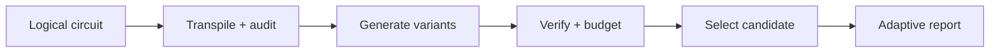
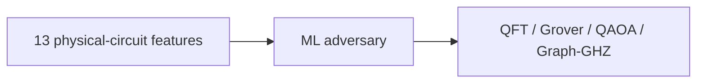
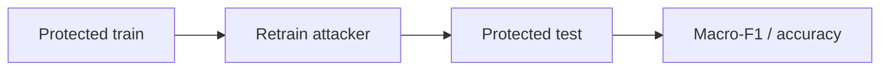
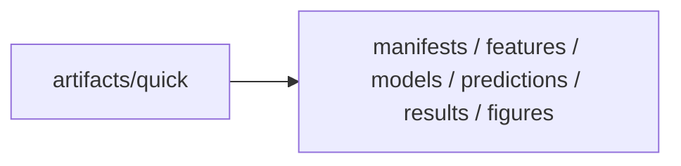
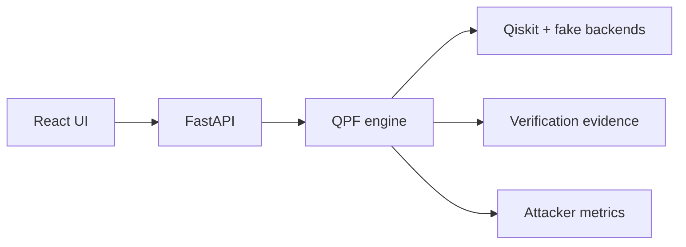
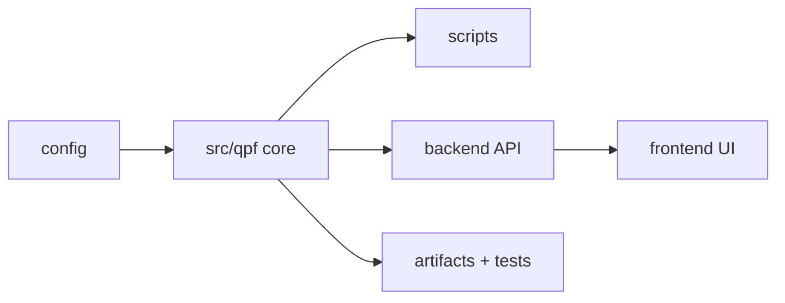

# Quantum Privacy Firewall

[](https://www.python.org/)
[](https://www.ibm.com/quantum/qiskit)
[](https://fastapi.tiangolo.com/)
[](https://react.dev/)
[](https://scikit-learn.org/)


**A privacy-aware compilation firewall for detecting and reducing algorithmic-intent leakage from transpiled quantum circuits.**

Built for **Q-Hack India 2026: Quantum Security & Cryptography Track**.

## The Problem

Quantum cloud computing introduces an emerging **program-privacy attack surface**: protecting a quantum algorithm's source code does not necessarily protect its computational intent.

Before execution, quantum circuits are **transpiled** into hardware-compatible physical circuits through native-gate decomposition, physical-qubit mapping, routing, and backend-aware optimization. This process can preserve identifiable structural fingerprints in **gate composition, two-qubit interaction patterns, qubit utilization, and coupling-edge load**.

Recent research by Beat Buesser and Anil Kurmus, IBM Research demonstrates that an observer can exploit these fingerprints to infer the **coarse algorithmic intent** of a workload from its final transpiled circuit alone, without access to the source program or intermediate compiler state.

> **The backend-visible circuit itself becomes an information-leakage channel for proprietary quantum workloads.**

## Our Solution

**Quantum Privacy Firewall (QPF)** tackles the defensive side of this recent IBM Research problem by introducing a **pre-submission, privacy-aware compilation layer** between the developer and the quantum backend.

QPF **audits structural intent leakage**, generates alternative circuit representations through **semantics-preserving transformations**, verifies **quantum equivalence**, enforces **hardware-overhead budgets**, and evaluates whether the resulting protection survives **adaptive machine-learning attackers retrained on protected circuits**.

> **Goal: reduce the recoverability of algorithmic intent before a quantum circuit leaves the developer's environment, without changing what it computes or making it impractical to execute.**

---

## What QPF Does



A protected candidate must be equivalent to the original circuit, compile on the target backend, create an observable changed physical circuit, remain within overhead limits, and survive evaluation against attackers trained on protected circuits.

---

## Core Pipeline

### 1. Generate Quantum Workloads

QPF deterministically generates Qiskit circuits from `(family, width, seed)`.

| Family | Representative workload |
| --- | --- |
| `qft` | Quantum Fourier Transform |
| `grover` | Grover-style search / amplitude amplification |
| `qaoa` | QAOA optimization circuits |
| `graph_ghz` | Graph-state and GHZ entanglement |

`random` is used as a separate control family.

Implementation: [`src/qpf/circuits.py`](src/qpf/circuits.py)

### 2. Hardware-Aware Transpilation

Circuits are compiled with Qiskit against IBM fake backends. The research pipeline uses `FakeNighthawk`; the interactive demo also supports `FakeSherbrooke` and `FakeBrisbane`.

Transpilation exposes the artifacts relevant to leakage: native gate decomposition, physical-qubit mapping, routing, optimization-level behavior, coupling-map pressure, active-wire usage, and backend-edge activity.

Implementation: [`src/qpf/compilation.py`](src/qpf/compilation.py)

### 3. Extract the Structural Fingerprint

QPF extracts 13 normalized features from the **final physical circuit**:

- **Gate mix**: two-qubit fraction, `rz`, `sx`, and `x` fractions
- **Temporal structure**: mean two-qubit activity, burstiness, early/mid/late two-qubit mass
- **Spatial structure**: active-qubit fraction, qubit-load Gini, edge entropy, max edge share

It also records depth, total operations, two-qubit count, and active physical qubits for overhead accounting and metadata controls.

Implementation: [`src/qpf/features.py`](src/qpf/features.py)

### 4. Attack the Circuit

QPF trains attackers on final-circuit features under source-disjoint train/test splits.



Attackers include Random Forest, Logistic Regression, Gradient Boosting, and a normalization-aware Random Forest. Controls include shuffled-label and metadata-only baselines.

Implementation: [`src/qpf/attacks.py`](src/qpf/attacks.py)

---

## The Privacy Firewall

After auditing leakage, QPF searches for alternative representations of the same computation.

| Strategy | What it changes |
| --- | --- |
| Equivalent decomposition | Rewrites gates such as `cx`, `cz`, `h`, `x`, `rx`, `swap`, `cp`, `rzz` |
| Dependency-preserving reordering | Reorders independent operations while preserving qubit dependencies |
| Layout diversification | Changes logical-to-physical placement on connected backend qubits |

Strategies can be combined: `decomp`, `reorder`, `layout`, `decomp+reorder`, `decomp+layout`, `reorder+layout`, `decomp+reorder+layout`.

Implementation: [`src/qpf/defenses.py`](src/qpf/defenses.py)

---

## Correctness and Cost

Every candidate is verified before selection. QPF uses Qiskit `Operator.equiv`, MQT QCEC when available, and layout-aware compiled-circuit verification in the web workflow.

```text
PASS / FAIL / UNKNOWN
```

Only `PASS` candidates can be selected. Candidates are also filtered by relative depth overhead, two-qubit gate overhead, and active-physical-qubit overhead.

Candidates that fail verification, fail compilation, exceed budget, or compile back to an unchanged physical circuit are rejected.

Implementation: [`src/qpf/verification.py`](src/qpf/verification.py), [`src/qpf/selection.py`](src/qpf/selection.py)

---

## Adaptive Evaluation

QPF evaluates a stronger attacker that knows the defense exists and can train on protected circuits.



This separates actual robustness from simple distribution shift.

---

## Experimental Validity

- **Source-disjoint split**: all variants of a logical circuit share a `base_id`, preventing train/test leakage.
- **Label-free selection**: held-out labels are never used to choose protected candidates.
- **Adaptive evaluation**: attackers are retrained on protected training circuits.
- **Traceable results**: metrics are backed by saved predictions, manifests, configs, and frozen test IDs.

---

## Results

The committed **quick-profile benchmark** provides a reproducible proof of concept.

### Baseline Intent Leakage

| Evaluation | Macro-F1 |
| --- | ---: |
| Full-feature Random Forest | **0.937** |
| Shuffled-label control | 0.409 |
| Metadata-only control | 0.874 |
| Random chance | 0.250 |

The baseline classifier learns algorithm family above chance. The strong metadata-only score shows that resource metadata is also a leakage channel.

### Adaptive Defense Evaluation

| Budget | Adaptive RF | Logistic Regression | Gradient Boosting | Normalization-Aware |
| ---: | ---: | ---: | ---: | ---: |
| 0% | 0.937 | 0.817 | 0.937 | 0.782 |
| 10% | 0.874 | 0.874 | 0.806 | 0.718 |
| 20% | 1.000 | 0.816 | 0.813 | 0.879 |
| 50% | **0.626** | 0.679 | **0.441** | 0.873 |

These results show that equivalent transformations can change attacker performance, but privacy improvement is attacker- and budget-dependent. QPF's contribution is the reproducible framework: leakage audit, verified transformations, cost filtering, and adaptive evaluation.



---

## Interactive Circuit Lab

The React + FastAPI demo runs QPF on individual circuits. Users configure family, width, seed, backend, optimization level, candidate count, strategies, and overhead budget. The app displays the logical circuit, baseline transpiled circuit, selected candidate, verification evidence, rejection reasons, metrics, attacker prediction, benchmark metrics, and QASM/JSON exports.



---

## Repository Structure



---

## Quick Start

### Requirements

- Python 3.10+
- Node.js 22.12+
- Git

### Install

```bash
git clone https://github.com/Usainbond007/qpf.git
cd qpf

python3 -m venv .venv
source .venv/bin/activate
python -m pip install --upgrade pip
python -m pip install -r requirements.txt
python -m pip install -e .
```

### Run the Research Pipeline

```bash
python scripts/reproduce_all.py --profile smoke
python scripts/reproduce_all.py --profile quick
```

### Run the Web Application

Backend:

```bash
python -m uvicorn backend.app.main:app --host 127.0.0.1 --port 8000
```

Frontend:

```bash
cd frontend
npm ci
npm run dev
```

Open `http://localhost:5173`.

---

## Testing

```bash
pytest -q
cd frontend
npm test
npm run build
```

Tests cover split disjointness, deterministic features, equivalence verification, invalid-circuit rejection, budget boundaries, label-free selection, API behavior, compiled-circuit verification, benchmark traceability, and frontend interactions.

---

## Research Basis

QPF was motivated by **Beat Buesser and Anil Kurmus, IBM Research**, *Algorithmic Intent Leakage in Transpiled Quantum Circuits: An Initial Reverse-Engineering Study*, IEEE Quantum Week 2026.

This repository is an independent implementation, not IBM Research source code or an official IBM project.

---

## Scope and Current Limitations

Current research directions include balanced workloads to reduce metadata confounds, feature-importance studies, cross-backend generalization, stronger adaptive attackers, compiler-resistant transformations, and noisy-simulator or hardware evaluation.

