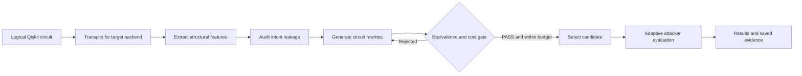
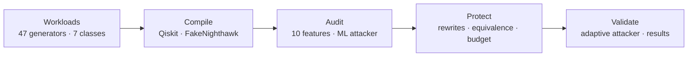
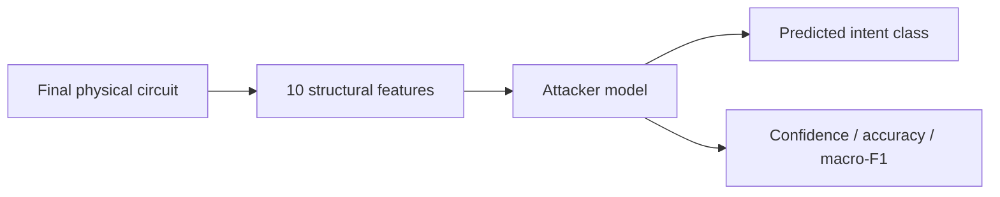
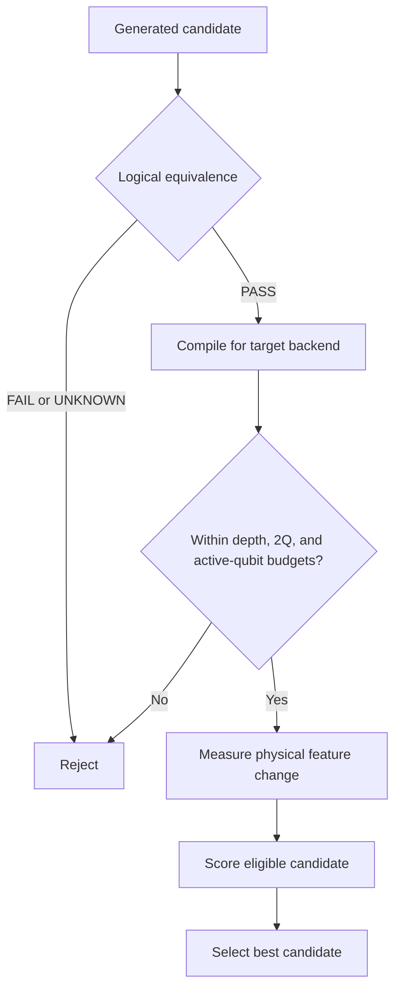
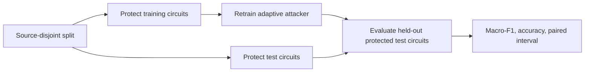

# Quantum Privacy Firewall

[](https://www.ibm.com/quantum/qiskit)
[](https://github.com/cda-tum/mqt-qcec)
[](https://scikit-learn.org/)
[](https://jupyter.org/)
[](https://fastapi.tiangolo.com/)
[](https://react.dev/)

**A Qiskit-based framework for measuring and reducing algorithmic-intent leakage from transpiled quantum circuits.**

Developed by **Fork Around & Find Out** for **Q-Hack India 2026**, Quantum Security & Cryptography track.

## The Problem

**A quantum algorithm can keep its source code private and still reveal what it is doing.**

Before a circuit reaches a quantum processor, a compiler translates its gates, maps qubits onto hardware, routes interactions, and optimizes the result. That final circuit is the version a backend receives. Its gate mix, depth, two-qubit interactions, and hardware usage can form a recognizable fingerprint.

An observer of that compiled circuit may infer the **algorithm family** without seeing the original program. Research by Beat Buesser and Anil Kurmus at IBM Research demonstrated this algorithmic-intent leakage. QPF tackles the question it raises for developers of proprietary quantum workloads:

> **Can we make the circuit harder to recognize without changing the computation it performs?**

## Our Solution

**Quantum Privacy Firewall (QPF)** is a pre-submission analysis and transformation pipeline. It audits intent leakage, searches for equivalent circuit rewrites, verifies candidates, enforces hardware-cost budgets, and measures the result against attackers retrained on protected circuits.



The project has two connected parts: a **seven-class research benchmark** that measures leakage and defense effectiveness across datasets, and a **single-circuit demo** that makes every step visible for a presentation.

## System Architecture



| Layer | Technology | Role |
| --- | --- | --- |
| Quantum circuit generation | Python, Qiskit | Build logical workloads across seven algorithm families |
| Compilation | Qiskit, FakeNighthawk | Produce hardware-compatible physical circuits |
| Attacker | scikit-learn | Predict algorithm family from compiled-circuit features |
| Defense | Qiskit transformations | Generate alternative representations of the same computation |
| Verification | Qiskit, MQT QCEC, DAG checks | Record `PASS`, `FAIL`, or `UNKNOWN` equivalence outcomes |
| Evaluation | pandas, NumPy, scikit-learn | Measure leakage, overhead, controls, and adaptive robustness |
| Demonstration | Jupyter, terminal, FastAPI, React | Present experiments and inspect individual circuits |

## Implementation

### 1. Quantum Workload Library

QPF implements **47 circuit generators across seven intent classes**. The full benchmark uses six variants per generator, or **282 logical source circuits**.

| Intent class | Representative workloads |
| --- | --- |
| Entanglement generation | GHZ, graph states, cluster states |
| Fourier-like | QFT, inverse QFT, phase estimation |
| Phase/oracle-like | Parity and phase oracles |
| Amplitude amplification | Grover search and related circuits |
| Variational ansatz | Hardware-efficient ansatz, QAOA |
| Hamiltonian simulation | Trotterized Ising, XXZ, Heisenberg models |
| Arithmetic/permutation | Adders, incrementers, comparators, Toffoli networks |

The generator audit records **24 semantic checks, 20 structural checks, and three structural analogues**. It also identified and helped correct errors in the incrementer, comparator, and parity-amplitude-amplification circuits.

Code: [`src/qpf/paper_circuits.py`](src/qpf/paper_circuits.py) · Audit: [`docs/GENERATOR_AUDIT.md`](docs/GENERATOR_AUDIT.md)

### 2. Backend-Aware Compilation

Circuits are transpiled for **FakeNighthawk**, a 120-qubit backend target, at optimization levels **0-3** and circuit sizes **24 and 48 qubits**. This produces **2,256 transpiled circuit records** in the full benchmark.

The attacker sees features of the *final compiled circuit*, after gate translation, mapping, routing, and optimization. QPF evaluates classification both within a compiler setting and across settings because transpilation can substantially change the observable fingerprint.

Code: [`src/qpf/compilation.py`](src/qpf/compilation.py) · Configuration: [`config/paper.yaml`](config/paper.yaml)

### 3. Structural Fingerprint

QPF extracts ten features from each final physical circuit.

| Feature | What it measures |
| --- | --- |
| Two-qubit gate fraction | Share of operations acting on two qubits |
| Phase/rotation fraction | Share of phase and rotation operations |
| Single-qubit gate entropy | Diversity of single-qubit gate types |
| Two-qubit layer fraction | Share of layers with two-qubit operations |
| Mean two-qubit operations per layer | Interaction density over depth |
| Layer two-qubit Gini | Concentration of interactions across layers |
| Used hardware-edge fraction | Portion of backend connections exercised |
| Edge two-qubit Gini | Concentration of operations across connections |
| Maximum edge-load fraction | Activity on the busiest connection |
| Qubit two-qubit Gini | Concentration of interactions across qubits |

Depth, total operations, two-qubit gate count, and active physical qubits are also recorded for resource accounting and control experiments.

Code: [`src/qpf/paper_features.py`](src/qpf/paper_features.py)

### 4. Intent-Leakage Attack

A **Random Forest** classifier predicts one of seven algorithm families from the final circuit's features. Experiments also include Logistic Regression, Gradient Boosting, normalization-aware attacks, shuffled-label controls, and metadata-only classification.

Compiled variants of the same logical source remain in the **same train or test partition**. Training-only grouped cross-validation selects attacker hyperparameters. The benchmark measures transfer across optimization levels and circuit sizes, joint-size training, and generalization to held-out generator types.



Code: [`src/qpf/paper_benchmark.py`](src/qpf/paper_benchmark.py)

### 5. Circuit Rewrite Engine

| Strategy | What changes |
| --- | --- |
| `decomp` | Equivalent gate decompositions |
| `reorder` | Order of independent operations, preserving dependencies |
| `layout` | Logical-to-physical qubit placement |
| `seed` | Transpiler decisions influenced by seed variation |
| Combined strategies | Decomposition, reordering, and layout together |

Qiskit may optimize a proposed logical change away. QPF examines the *compiled candidate* to determine whether the attacker-visible features changed.

Code: [`src/qpf/defenses.py`](src/qpf/defenses.py)

### 6. Verification, Budget, and Selection

Every candidate receives an equivalence result of **`PASS`**, **`FAIL`**, or **`UNKNOWN`**. Depending on the circuit, QPF uses Qiskit operator equivalence, **MQT QCEC**, dependency-DAG identity, or identical-logical-circuit evidence when only compilation settings changed. An unsupported or timed-out check is `UNKNOWN`.



The full defense run recorded **1,974 generated candidates**, all with `PASS` logical-equivalence evidence:

| Verification method | Candidates |
| --- | ---: |
| MQT QCEC | 846 |
| DAG identity | 564 |
| Identical logical circuit | 564 |
| **Total** | **1,974** |

Candidates are also filtered by relative increases in **depth**, **two-qubit gate count**, and **active physical qubits**. Budgets of **0%, 10%, 20%, and 50%** are evaluated. Guided selection prefers lower confidence from a surrogate classifier trained on training data; held-out test labels are not used at selection time. Random eligible selection provides a comparison.

Code: [`src/qpf/verification.py`](src/qpf/verification.py) · [`src/qpf/selection.py`](src/qpf/selection.py)

### 7. Adaptive Evaluation

An informed attacker may retrain after observing protected examples. QPF trains adaptive attackers on **protected training circuits** and scores them on **held-out protected circuits**. Static, adaptive Random Forest, Gradient Boosting, Logistic Regression, and normalization-aware results are reported separately.



Code: [`src/qpf/paper_defense.py`](src/qpf/paper_defense.py)

## Prototype and Demo

The prototype includes the reproducible research pipeline, a **Jupyter notebook**, a **terminal attack demonstration**, saved tables and plots, and an interactive circuit-inspection application.

### Notebook

```bash
jupyter lab notebooks/demo.ipynb
```

The notebook brings together benchmark tables, verification evidence, candidate budgets, adaptive defense results, confidence plots, and circuit drawings.

### Terminal Attack Demonstration

```bash
python scripts/demo_attack.py
```

The default run attacks a **24-qubit QFT** at optimization level 3 under a **20% overhead budget**. The attacker is trained from the saved final dataset without the victim's source circuit.

| Stage | Recorded result |
| --- | ---: |
| Attacker confidence before protection | 100% |
| Rewrite candidates generated | 21 |
| Candidates with `PASS` equivalence evidence | 21 |
| Candidates inside the 20% budget | 12 |
| Selected strategy | `decomp+reorder` |
| Attacker confidence after protection | 51% |

The selected candidate has a **9.9% lower depth** and **14.4% more two-qubit gates** than the original compiled circuit, remaining within the 20% budget. The demo exports candidate tables and confidence plots to [`artifacts/demo_attack/`](artifacts/demo_attack/).

```bash
python scripts/demo_attack.py --generator grover
python scripts/demo_attack.py --generator ghz --budget 0.5
```

The single-victim demo illustrates the mechanism. The dataset-level results below measure the defense against retrained attackers.

## Results and Validation

### Baseline Intent Leakage

The independent QPF benchmark shows high algorithm-family recognition when compilation settings match and more difficult transfer across some settings.

| Evaluation | QPF accuracy |
| --- | ---: |
| Within optimization level | 0.93-0.99 |
| Cross-level transfer, excluding levels 2 ↔ 3 | 0.22-0.52 |
| Level 2 → 3 / level 3 → 2 | 0.906 / 0.912 |
| Within 24-qubit / 48-qubit settings | 0.935 / 0.960 |
| 24 → 48 / 48 → 24 transfer | 0.634 / 0.250 |
| Joint 24+48 training, tested at 24 / 48 qubits | 0.953 / 0.960 |

Control experiments help explain the classification signal:

| Check | Accuracy | Interpretation |
| --- | ---: | --- |
| Full structural features | 0.956 ± 0.007 | Strong intent signal in the tested distribution |
| Shuffled labels | 0.138 ± 0.011 | Approximately seven-class chance |
| Basic resource metadata only | 0.938 ± 0.006 | Size and resource usage carry substantial signal |
| Held-out generator types | 0.687 ± 0.050 | Unseen constructions are harder to classify |

The strong metadata-only result shows why controls matter: some predictive power comes from resource patterns as well as the ten structural features.

### Adaptive Defense Evaluation

The **unprotected adaptive Random Forest baseline** was **0.916 ± 0.007 macro-F1** over five repeated source-disjoint splits. Seven-class chance is approximately **0.143**.

| Overhead budget | Guided adaptive RF | Random eligible RF | Paired 95% CI for guided reduction | Mean guided cost |
| ---: | ---: | ---: | --- | --- |
| 0% | 0.904 | 0.914 | −0.006 to +0.030 | −2.3% depth / −2.8% 2Q |
| 10% | 0.879 | 0.900 | +0.017 to +0.058 | −2.1% depth / −2.9% 2Q |
| 20% | 0.878 | 0.887 | +0.017 to +0.059 | −0.6% depth / −1.9% 2Q |
| 50% | **0.865** | 0.883 | **+0.029 to +0.073** | +5.5% depth / +3.5% 2Q |

At the 50% budget, guided selection lowered adaptive attacker macro-F1 by **0.051 absolute**, from **0.916 to 0.865**. The paired confidence interval is positive at 10%, 20%, and 50% budgets. Guided selection also outperformed random eligible selection in these recorded comparisons.

The defense evaluation uses **24-qubit circuits**, optimization levels **0, 2, and 3**, and FakeNighthawk. Equivalence evidence applies to logical rewrites; cost and leakage are measured on their compiled versions.

Full saved results: [`artifacts/paper_full/results/defense_summary.md`](artifacts/paper_full/results/defense_summary.md) · [`artifacts/paper_full/results/paper_comparison.md`](artifacts/paper_full/results/paper_comparison.md)

## Repository Guide

| Path | Purpose |
| --- | --- |
| `src/qpf/paper_circuits.py` | Seven-class workload generators |
| `src/qpf/paper_features.py` | Ten physical-circuit features |
| `src/qpf/paper_benchmark.py` | Leakage and generalization experiments |
| `src/qpf/paper_defense.py` | Adaptive defense evaluation |
| `src/qpf/defenses.py` | Rewrite strategies |
| `src/qpf/verification.py` | Equivalence decisions |
| `src/qpf/selection.py` | Budget and selection rules |
| `config/paper.yaml` | Benchmark settings and seeds |
| `scripts/` | Experiment and demo commands |
| `notebooks/demo.ipynb` | Visual research demonstration |
| `artifacts/paper_full/` | Saved benchmark datasets and results |
| `artifacts/demo_attack/` | Single-victim plots and tables |
| `backend/` and `frontend/` | Interactive circuit-inspection application |
| `tests/` | Generator, feature, verification, and split tests |

The repository retains an earlier exploratory pipeline. The **seven-class, ten-feature benchmark** is the primary experiment reported here.

## Quick Start

### Requirements

- Python 3.10 or newer
- Git
- Dependencies in `requirements.txt`
- Node.js for the optional React interface

### Install

```bash
git clone https://github.com/Usainbond007/Quantum-Privacy-Firewall.git
cd Quantum-Privacy-Firewall
python -m venv .venv
source .venv/bin/activate
python -m pip install -r requirements.txt
python -m pip install -e .
```

On Windows PowerShell, use `.\.venv\Scripts\Activate.ps1` instead of the `source` command.

### Run a Small Pipeline Check

```bash
python scripts/build_paper_dataset.py --profile smoke
python scripts/run_paper_benchmark.py --profile smoke
python scripts/run_paper_defense.py --profile smoke
```

The saved full-profile results are under [`artifacts/paper_full/`](artifacts/paper_full/). A full reproduction takes substantially longer than the demo.

### Run Tests

```bash
python -m pytest -q tests backend/tests
```

## Research Basis and Acknowledgments

QPF builds on the research direction described by **Beat Buesser and Anil Kurmus**, IBM Research, in *Algorithmic Intent Leakage in Transpiled Quantum Circuits: An Initial Reverse-Engineering Study* ([IBM Research publication](https://research.ibm.com/publications/algorithmic-intent-leakage-in-transpiled-quantum-circuits-an-initial-reverse-engineering-study)).

QPF's generators, dataset construction, feature conventions, rewrite engine, and defense evaluation are independently implemented. The project extends the intent-leakage question into **verified circuit transformation and adaptive defense testing**.

Built with Qiskit, MQT QCEC, scikit-learn, Jupyter, FastAPI, and React.
