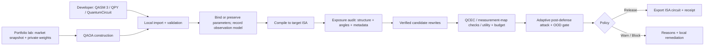

# QPF: a security gateway for quantum jobs

**Research and build strategy for Q-Hack India 2026**  
Prepared 25 October 2026. This is a proposal and evidence audit, not a claim that the proposed extensions have already been implemented or validated.

## Executive decision

Build **QPF Preflight**, a developer-facing gate between a Qiskit circuit and a cloud quantum job. The flagship use case is **confidential portfolio optimization**: a researcher selects risk, return, and diversification preferences; a QAOA workload is compiled for quantum hardware; QPF measures what an observer of the submission can infer, attempts verified low-overhead transformations, and either releases an auditable artifact or blocks the job. The same gateway also accepts a basic developer's uploaded circuit.

This is not QKD, post-quantum cryptography, or encryption of a quantum computation. It is **information-leakage testing and policy enforcement at the quantum compilation/submission boundary**. The central research question is: *Which facts about a user's workload survive compilation, and can any be reduced without breaking the computation or its useful output?*

The project has a strong foundation, but the existing measurements do **not** prove that portfolio preferences are hidden. That question becomes the new experiment. The strongest possible live result may be a demonstrated **block**: QPF detects that numerical parameters remain exposed even when circuit structure has changed. A truthful failure is a useful security decision.

## 1. Why this is timely and judge-relevant

The [official Q-Hack India rubric](https://www.quantumweek.tech/hackathon) assigns 30% to technical implementation, 20% to originality, 20% to quantum relevance, 10% to problem significance, 10% to impact, and 10% to presentation. The event permits quantum-classical hybrid software; the final build/pitch is 30-31 October 2026. The official site contains some conflicting older Round 1 dates, so use organizer email for logistics, not this document.

Three independently sourced facts make the problem real:

1. [IBM Research's QCE 2026 study](https://research.ibm.com/publications/algorithmic-intent-leakage-in-transpiled-quantum-circuits-an-initial-reverse-engineering-study) shows that **coarse algorithmic intent can be inferred from final backend-transpiled circuits** under its experimental conditions. QPF independently builds on the idea; it is not IBM's implementation or an IBM-endorsed security product.
2. [IBM's multi-objective portfolio tutorial](https://quantum.cloud.ibm.com/docs/en/tutorials/quantum-approximate-multi-objective-optimization) provides a working QAOA workflow with risk, return, diversification, an eight-asset teaching example, and a 40-asset example using a public real-market-data snapshot. Objective weights are circuit parameters and are swept in a sampler job. The tutorial explicitly does **not** claim quantum advantage: its 40-asset QAOA hypervolume is 85.5% of the exact ceiling; matched random sampling is 84.4% +/- 1.3%.
3. [IBM and Vanguard published exploratory portfolio-construction research](https://www.ibm.com/quantum/blog/vanguard-portfolio-optimization), including a 109-qubit hardware experiment. That establishes industry exploration, **not** a documented breach, a production adoption claim, or a claim that Vanguard's jobs need QPF.

The defensible impact is pre-submission risk control for proprietary research workflows. It is **not** that other customers can browse each other's IBM jobs. A realistic attacker is an authorized-but-curious provider insider, a compromised project credential, an overly broad internal collaborator, a logging/telemetry recipient, or an accidentally shared job artifact. [AWS Braket's security documentation](https://docs.aws.amazon.com/braket/latest/developerguide/security.html) explicitly frames customer data protection as shared responsibility; it is context, not proof of a Braket breach.

## 2. Exact threat model: three different things can leak

| Observer | What they see | What QPF currently measures | New research/product response |
|---|---|---|---|
| A: physical-circuit observer | Backend-native gate sequence, gate types, timing/layers, used couplers; no source, labels, or parameters beyond gate representation | The paper-aligned 10-feature family classifier on FakeNighthawk | Upload path, broader circuit coverage, out-of-distribution status, adaptive post-defense evaluation |
| B: job-payload observer | Physical circuit **plus numerical gate angles or Runtime parameter-binding arrays** | Not adequately assessed by the 10 structural features | Parameter-exposure detector, preference-inference test, reject if a protected preference is recoverable |
| C: source/artifact observer | Original QASM/QPY, CSV, variable names, comments, job metadata, or logs | Outside the research attack | Local parsing, redaction/minimal export, secret-free audit records, access-control guidance |

The product must state **which observer** each score represents. An attacker limited to A is *not* the same as a provider operator who can inspect B. [IBM's tutorial](https://quantum.cloud.ibm.com/docs/en/tutorials/quantum-approximate-multi-objective-optimization) builds a `ParameterVector("c", 3)` for objective weights and submits weight vectors as a batched sampler parameter payload; those values are outside a structural-only classifier's observation. If the same parameterized circuit is used for both risk-first and return-first cases, A might have **zero preference signal**. That is an important potential negative result, not a reason to alter the experiment.

**Security claim boundary:** Equivalent rewrites preserve the unitary/output semantics but do not automatically conceal encoded coefficients. They provide no general cryptographic confidentiality guarantee. If a preference is explicitly recoverable from angles or bindings, QPF must say so and block, or use a separately validated, keyed application-level scheme. Transport encryption and account-level authorization remain necessary but solve different problems.

## 3. What the repository already proves

Read the following as measured **repo artifacts**, not as results of the proposed portfolio extension.

| Existing capability | Evidence in this repository | Important qualification |
|---|---|---|
| Seven coarse intent families; 47 generators | `src/qpf/paper_circuits.py`, `docs/GENERATOR_AUDIT.md` | Controlled generators, not an arbitrary uploaded-workload population |
| Ten physical-circuit structural features | `src/qpf/paper_features.py` | Independent interpretation of the IBM paper; no numerical parameter leakage model |
| 24/48-qubit compiled benchmark | `artifacts/paper_full/results/paper_comparison.md` | 282 source circuits, 2,256 transpiled rows; five source-disjoint repetitions on FakeNighthawk |
| Within-setting intent leakage | Same comparison report | Pooled source-disjoint accuracy 0.956 +/- 0.007; metadata-only accuracy 0.938 +/- 0.006; generator-disjoint accuracy 0.687 +/- 0.050. Metadata and generator generalization are major caveats. |
| Candidate generation and semantic checking | `src/qpf/defenses.py`, `src/qpf/verification.py` | Local decomposition, legal reorder, layout/seed diversification; equivalence is checked at the logical rewrite, not generally after compilation |
| Budgeted defense evaluation | `artifacts/paper_full/results/defense_summary.md` | 1,974 generated candidates passed logical verification: 846 MQT QCEC, 564 DAG identity, 564 identical logical circuits |
| Adaptive post-defense attack | Same defense report | At 20% budget, adaptive macro-F1 0.916 -> 0.878, paired delta 0.038 with 95% CI +0.017 to +0.059. This is a modest reduction, not privacy. At 50%, 0.916 -> 0.865. |
| Single-victim terminal demonstration | `scripts/demo_attack.py` | Its confidence change is one fixed-attacker illustration; it is not the aggregate security outcome |
| Frontend/backend workflow | `frontend/`, `backend/app/` | Preset-generated 4-8-qubit circuits, not arbitrary uploads or the full 24/48-qubit paper research engine |

Existing `docs/STATUS.md` reports prior test runs, not fresh verification performed for this document. The current checkout has pre-existing changes to `README.md`, `notebooks/demo.ipynb`, and an untracked `README_FINAL.md`; this strategy document does not alter them.

## 4. Code-level gaps to close

| Gap | Where | Consequence | Focused fix |
|---|---|---|---|
| Presets only, width 4-8 | `backend/app/schemas.py`, `backend/app/routes/circuits.py` | A real developer cannot upload a Qiskit circuit | Add an import endpoint for bounded OpenQASM 3 and QPY, plus a notebook/Python `preflight(qc)` API. Retain presets as a safe demo mode. |
| Research engine and UI engine differ | `src/qpf/paper_features.py` versus `src/qpf/features.py`; `backend/app/services/demo.py` | A UI score can be mistaken for the published 10-feature result | Define a versioned `FeatureSchema`, attacker model registry, and coverage/OOD checks. Never silently load a model trained on another feature version. |
| Fallback score is not leakage | `backend/app/services/demo.py` | When no surrogate is configured, structural distance can look like privacy | Label it "structural change only" and prohibit an automatic `RELEASE` on that basis. |
| Existing API model is for a quick profile | `backend/app/services/accuracy.py` | It loads `artifacts/quick`, width 6/8, opt 0/2, not the paper-full classifier | Train/export a model specifically for the new observation schema; show its training domain on every report. |
| Classical bits and parameter handling | `src/qpf/defenses.py` reconstructs `QuantumCircuit(qc.num_qubits)` and casts certain parameters to `float` | Measured, conditioned, or symbolic circuits can be corrupted or rejected | Separate a supported **bound, unitary kernel** from terminal measurements. Preserve register mapping. Treat mid-circuit measurement/control or unbound expressions as unsupported until explicitly handled. |
| Equivalence semantics | `src/qpf/verification.py` | Unitary equality is not the same as measurement mapping or noisy utility | Check bound logical kernels; preserve/re-attach measurement map; check compiled layout/measurement semantics where supported; report UNKNOWN on timeout/unsupported. [MQT QCEC's compilation guide](https://github.com/munich-quantum-toolkit/qcec/blob/main/docs/compilation_flow_verification.md) details layout and measurement requirements. |
| All source circuits are generated | `src/qpf/paper_benchmark.py`, `src/qpf/paper_circuits.py` | Unknown-upload claims would be overconfident | Add external-family and generator-held-out tests; OOD detection and abstention. |
| One fake backend, logical cost only | `src/qpf/compilation.py` and paper-full artifacts | Hardware/noise transfer unknown | Add a second fake backend, approximate noise experiments, and a precise ISA-validity check. [Qiskit Aer](https://qiskit.github.io/qiskit-aer/tutorials/2_device_noise_simulation) supports device-noise simulation. |
| No private-preference head | Entire current paper pipeline | Cannot claim portfolio strategy privacy | Build a separate portfolio attacker and a payload-level exposure detector; do not relabel the seven-family classifier as this. |

## 5. Flagship workload: portfolio optimization, without pretending it is deployed by us

### Public inputs and genuinely private variable

Use the [Qiskit documentation's committed 40-asset market snapshot](https://raw.githubusercontent.com/Qiskit/documentation/main/datasets/tutorials/qmoo/market_data.csv), documented in the [IBM tutorial](https://quantum.cloud.ibm.com/docs/en/tutorials/quantum-approximate-multi-objective-optimization). It contains tickers, annualized expected returns, and a covariance matrix. Vendor-maintained data is public; **do not call it a bank's proprietary dataset**. Pin a Git commit and store a checksum for reproducibility before making figures. Keep the provenance and license alongside any local copy.

The confidential test variable is a synthetic analyst choice, e.g. `risk_first`, `balanced`, or `return_first`, encoded as a three-component objective-weight vector. These labels are **simulated business preferences** assigned by the team. They are not real investment recommendations, actual trading signals, or evidence of a company's strategy. A real customer might also have private forecasts, holdings, constraints, or risk models, but this prototype does not need to expose such data.

For each `n`-asset subset (start at 8; stretch to 12-16), let `x_i in {0,1}` choose assets with `sum(x_i)=K`. A demonstrative scalarized objective is

```text
maximize  - c_risk * x^T Sigma x
          + c_return * mu^T x
          + c_diversify * x^T D x
subject to sum_i x_i = K, c_j >= 0, sum_j c_j = 1.
```

Use the IBM tutorial's Hamiltonian construction, sign conventions, QAOA ansatz, and XY mixer exactly enough to avoid accidentally testing a different task. The eight-asset example in the tutorial has **illustrative hand-entered numbers**. For the "real-market-data" claim, form 8/12/16-asset subsets from the **40-asset CSV**, rebuild `mu`, `Sigma`, and sectors consistently, and state the subset selection rule. Exhaustive quality checks are easy at 8 assets, but not at 40.

### Two honest experiments, not one conflated headline

1. **Circuit-only observer:** For the *same asset subset, backend, QAOA depth, mixer, and compiler configuration*, compare compiled circuits across preference choices. Use QPF's ten structural features plus a stronger graph/gate-sequence attacker as a control. For a parameterized circuit, the structural-only view may be identical across preferences. Record chance as a valid result.
2. **Payload observer:** Compare the actual submitted ISA circuit **and parameter values**. Check whether preferences can be inferred from bound angles or binding vectors. Test a trivial parameter-reading baseline before ML; if it works, the problem is explicit disclosure, not sophisticated side-channel inference. QPF should block rather than claim its structural rewrites repaired this channel.

**Crucial experimental control:** Never train on one asset basket and test on a different preference for the same basket while allowing the basket or transpile seed to identify the label. Group train/test by market instance/asset subset and randomize compilation seeds and optimization levels across labels. Also test a within-instance paired setup to measure the effect of changing only `c`. Report feature-only, metadata-only, numeric-parameter-only, and combined attackers. A shuffled-label result should be at chance.

### What could actually protect the portfolio job?

There are three distinct product behaviors:

| Behavior | Does current QPF do it? | Defensible claim |
|---|---|---|
| Equivalent rewrite of circuit topology/gate composition | Yes, within supported logical circuits | May reduce a tested structural classifier's confidence; effectiveness is empirical and limited |
| Detect visible preference weights in gate angles or Runtime bindings, then block export | Proposed, feasible by finale | Prevents **QPF-mediated submission** of a known exposed job; does not protect jobs sent around the gateway |
| Keyed problem-level transformation with local inverse/decode | Research stretch, not current QPF | Could protect particular optimization variables **only if** proven correct and measured against adaptive attackers; not general circuit encryption |

For a small keyed experiment, an **asset-qubit permutation with private inverse mapping** can hide ticker labels if ticker labels never leave the client, while preserving bitstring meaning after local decoding. It does *not* hide graph isomorphism, distinctive coefficients, or objective weights, and may be reversible by a knowledgeable attacker. Treat it as a labeled, narrow protection experiment, not as the core guarantee.

The stronger literature comparator is [Enigma's revised application-layer QAOA privacy work](https://arxiv.org/abs/2311.13546): it describes coefficient scrambling, decoys, and topology changes with local solution recovery. Implementing its methods faithfully would be a separate research effort; the 2025 revision differs from the older 2023 abstract. Cite and compare it, do not copy claims into QPF or call a simple permutation Enigma. [OpaQue](https://doi.org/10.1145/3721145.3725771) and [SPYCE](https://arxiv.org/abs/2307.16799) also study circuit/output obfuscation. Their existence means **QPF is not the first quantum circuit obfuscator**. Its differentiator should be **attacker-in-the-loop preflight, explicit observation boundaries, proof/utility gates, and fail-closed decisions**.

## 6. Two entry points, one auditable engine



**Developer upload path.** Support an uploaded `.qasm` (OpenQASM 3) and `.qpy` file and an in-process `preflight(qc)` call. QPY preserves Qiskit circuit structure better than QASM; [IBM's QPY docs](https://quantum.cloud.ibm.com/docs/en/api/qiskit/qpy) explain the tradeoff. [QASM 3 importing](https://quantum.cloud.ibm.com/docs/en/api/qiskit/qasm3) has optional dependencies and incomplete feature coverage. Do **not** accept arbitrary `.py`, execute notebook uploads, or unpickle models from user input. Bound file size, widths, instruction count, parser time, permitted operations, and request CPU time. Reject unknown instructions/expressions clearly. Parse locally; do not upload the user's circuit to an external model service for analysis. Preserve a sanitized source hash, not confidential source text, in the audit report.

**Portfolio path.** Provide two clearly labeled modes: `tutorial 8-asset illustrative example` and `8 assets drawn from the 40-asset real-market snapshot`. The latter is the primary presentation mode. A selector changes only the confidential objective weights. Show the resulting cost-operator term count, circuit depth, two-qubit gates, measured bitstrings/portfolio choices, and leakage/utility metrics. A 40-asset diagram/compiled-circuit inspection is a stretch; do not promise fast exact simulation or QCEC at that width.

**Output contract.** The exported `SecurityReceipt` should record input hash, parser/feature/model versions, backend target, attacker observation mode, held-out-domain warning, baseline and post-defense attack results, equivalence method/status, depth/2Q overhead, noise/utility estimate, parameter exposure findings, policy decision, and timestamp. Avoid storing private weights in a downloadable receipt unless the user explicitly chooses a local full-detail export. A report should say `UNKNOWN`, not `PASS`, if verification times out.

## 7. Engineering sequence and precise acceptance gates

### P0: one working path (highest value)

1. Add an internal `CircuitArtifact` object containing logical circuit, measurement map, bound/parameterized status, provenance, and parsing warnings. Reject unsupported dynamic control flow, calibration/pulse, nonterminal measurements, unknown gates, and unbound transformations with a visible explanation. Keep the existing generator path untouched.
2. Add bounded QPY/QASM3 import to FastAPI and a pure-Python Qiskit API. Round-trip example circuits and compare counts/layout. Integration-test malformed and oversized inputs. An arbitrary `.py` upload is never executed.
3. Share the paper-aligned physical-feature and model code with the demo path, using versioned models. If a model does not match the uploaded circuit's width/backend/opt domain, show **out of distribution** and no numeric privacy verdict.
4. Add a `payload_exposure` analyzer for bound numerical rotations and Runtime parameter arrays. It does not need to reconstruct exact financial weights to be useful: it must at least identify that protected parameter values are present in the export. Test against the IBM tutorial's parameterized/fully bound variants.
5. Add a fail-closed release gate: `RELEASE` only if support, equivalence, budget, and configured risk thresholds pass; `WARN` for informational research-only cases; `BLOCK` for unsupported or known exposed secrets. Never silently return an unprotected circuit as a "protected" result.

### P1: scientifically credible portfolio evaluation

1. Reuse IBM's QAOA portfolio recipe, but take the demo subset from its **real-data CSV**. Pin versions, seed, CSV commit/hash, ticker subset, and `K`.
2. Generate balanced preference labels across many asset subsets and compilation seeds. Use group-held-out basket splits and repeated evaluation. Record both A and B attacker views, plus shuffled labels, parameter-only, and metadata-only controls.
3. Run original and defended circuits with exact simulator at 8 qubits and Qiskit Aer noise approximation for feasible widths. Compare post-selection feasibility rate, expected objective value under the *original* objective, top feasible portfolio overlap, distribution distance, and Pareto hypervolume where appropriate. Match shots and seeds. Do not interpret a noisy-simulator result as real hardware performance.
4. Evaluate adaptive retraining after protection. Report aggregate accuracy, balanced accuracy, macro-F1, bootstrap confidence intervals, support, and a confusion matrix. A single circuit's prediction confidence belongs in a demo panel, not the executive claim.
5. Add a second fake backend or show explicit OOD abstention. Verify ISA validity before export; Qiskit requires hardware-target ISA circuits for submission ([IBM transpilation guide](https://quantum.cloud.ibm.com/docs/en/guides/transpile)).

### P2: only if P0/P1 are stable

Implement a clearly attributed application-level masking comparator inspired by the relevant literature, **with local decode and an attacker seeing the transformed problem**. Verify decoded objective/solution quality, key handling, overhead, and attacked leakage. This is more interesting than adding a decorative dashboard, but too risky to substitute for a working P0. Any transformation that changes the problem generally cannot be validated with the current `same unitary` QCEC call; it needs a different correctness contract.

## 8. Evaluation design that will withstand questions

| Question | Measurement | Required control / caveat |
|---|---|---|
| Does the circuit reveal algorithm family? | Accuracy and macro-F1 of paper-aligned structural attacker on source-disjoint held-out circuits | Metadata-only, shuffled labels, unseen generator, second backend |
| Does the **portfolio preference** leak? | Balanced accuracy / macro-F1 for 3 labels; optionally weight-regression MAE | Same public data across labels, held-out asset baskets; A and B observers separately; trivial angle/parameter baseline |
| Did defense help a real attacker? | Original vs defended **adaptive** attacker, paired by source instance | Retrain on protected examples; include normalization-aware attack; show CI, not just one confidence drop |
| Is the circuit still correct? | QCEC on supported bound logical unitary; measurement map and compiled semantic check where applicable | PASS / FAIL / UNKNOWN. Respect QCEC's layout and measurement semantics; [MQT docs](https://github.com/munich-quantum-toolkit/qcec/blob/main/docs/compilation_flow_verification.md) |
| Is it still useful on hardware? | Depth, two-qubit gates/depth, shot-based objective, feasible fraction, TV distance/Hellinger, optional hypervolume | Same shots, backend noise model, and classical/random baseline; QCEC alone is insufficient |
| Is QPF operationally safe? | Import success/rejection, scan runtime, false-block rate, OOD abstention, audit receipt integrity | Do not execute uploaded Python; no external LLM call; no secrets in logs |

Set quantitative pass criteria **before** running, for example: 100% of intentionally unsupported uploads rejected; 100% of `UNKNOWN` verification outcomes blocked; no protected release on an unexamined parameter payload; unchanged ideal output for supported unitary rewrites; no more than a chosen overhead budget; and a statistically supported reduction in *adaptive* attacker performance if claiming privacy improvement. If preference inference is at chance for observer A, say so. If B recovers the weights, make the demonstrable product outcome **block**, not a fabricated success.

## 9. Demo storyboard: 3 minutes, honest and memorable

1. **Hook (15 s):** A developer is about to submit a Qiskit job. "The circuit is the workload. What does the job itself reveal?" Explain that this is security *for quantum programs*, distinct from using quantum to secure messages.
2. **General developer (35 s):** Upload a QFT or Grover QPY/QASM. Show original vs backend-compiled circuit, attacker family prediction, and which observable features contribute. Run verified rewrite candidates and display `PASS`, overhead, post-defense result, and release decision. The old aggregate 0.916 -> 0.878 at 20% belongs in a small evidence panel with its limitation.
3. **Industry application (55 s):** Select 8 public-market-data assets, then `risk-first` vs `return-first` weights. Display the same data and different private preference. Toggle observer A (circuit-only) and B (full job payload). If A cannot distinguish but B sees numerical values, that contrast is the reveal: "different visibility, different security claim." QPF blocks the unsafe payload; do not pretend equivalent rewrites hid it.
4. **Technical proof (45 s):** Show the local pipeline, QCEC verdict, paired utility plot, overhead budget line, adaptive attack/confusion matrix, and failure/abstention states. Show a selected verified release for a supported general circuit if available; show block for exposed portfolio payload.
5. **Close (30 s):** Present the downloadable receipt and the future research path: keyed problem-level privacy plus attacker-in-the-loop testing. State that the prototype is a pre-submission gate, not an unbreakable encrypted quantum computer.

If an optional masking implementation actually passes the P2 evaluation, replace the portfolio block with a **before -> masked job -> locally decoded portfolio** sequence, but only display real measured results. Nothing in this document assumes that outcome.

### Visuals worth producing

- Side-by-side logical vs ISA circuit, cropped to a readable 8-qubit example; color gate classes consistently.
- Two-view exposure matrix: structural features versus numerical job payload.
- Scatter/Pareto plot of candidate defenses: adaptive leakage on one axis, two-qubit overhead on the other; mark verified candidates and the chosen budget.
- Preference-attacker confusion matrices for A and B, including chance and confidence intervals.
- Noisy-vs-ideal expected portfolio objective and feasibility rate, with classical/random comparator.
- One-page security receipt, not a page of unsupported green "secure" badges.

## 10. What is distinctive, and what is not

| Possible statement | Judgment |
|---|---|
| "We discovered quantum circuit privacy" | False. IBM, Enigma, OpaQue, SPYCE, and other work predate QPF. |
| "QPF reproduces IBM's exact experiment/code" | False. The repo states that its generators and feature conventions are an independent interpretation. |
| "We provide a measured preflight gate connecting circuit-intent attack, verified rewrites, budget, adaptive retest, parameter exposure, and explicit release/block policy" | A credible **target product claim** if P0/P1 are built and tested. |
| "Portfolio weights are protected by our current rewrites" | Unsupported and likely false for a payload observer. |
| "Portfolio optimization is already commercially quantum-advantaged" | Unsupported. IBM's tutorial explicitly says its demonstrated 40-asset workflow is not. |
| "We proved no insider can infer anything" | Impossible from current evidence. State the modeled observer, dataset, and residual leakage. |
| "This protects a real bank's leaked strategy" | No documented incident in the cited sources; use a hypothetical customer scenario and public data. |

**One-sentence pitch:** "QPF is a pre-submission security gateway for quantum jobs: it tests what compiled circuits and parameter payloads disclose, verifies any low-cost defense, and blocks confidential workloads when the leak remains."

## 11. Feasibility and time allocation

With the finale days away, prioritize **one vertical slice**. A reasonable sequence for a three- or four-person team:

| Window | Engineering | Research/validation | Demo/presentation |
|---|---|---|---|
| Day 1 | Circuit import + supported-operation policy | Reproduce a small saved result; freeze dependency versions | Draw threat-model and flow diagrams |
| Day 2 | Shared feature/model registry + upload/API route | Build portfolio subset from pinned CSV; inspect parameter payloads | Draft storyboard with honest labels |
| Day 3 | Parameter-exposure detector + release/block receipt | Paired A/B preference experiment with controls | Prepare live fallback artifacts |
| Day 4 | Verification/measurement and noise utility path | Adaptive defense, confidence intervals, OOD check | Capture real figures and terminal/notebook run |
| Day 5 | Regression fixes, freeze demo | Audit claims against saved outputs | Rehearse 3-minute live narrative and Q&A |

Do not spend scarce time on 40-qubit exact simulation, an unverified "universal" masker, live paid-QPU dependence, or redesigning every screen. An 8-qubit real-data vertical slice plus the established 24/48-qubit research artifact is stronger than an unfinished 40-qubit privacy claim.

## 12. Source ledger: evidence, takeaway, and limits

These are primary research, vendor documentation, official project repositories, and official event pages. Company social posts are secondary promotion and are not used to establish technical efficacy. Search found an [IBM Quantum LinkedIn post about the IBM-Vanguard study](https://www.linkedin.com/posts/ibm-quantum_researchers-from-vanguard-and-ibm-introduce-activity-7378526862630752256-MkQ1), but the linked [IBM technical article](https://www.ibm.com/quantum/blog/vanguard-portfolio-optimization) is the evidence used here. No X post was needed to validate a technical claim.

| Source | What it establishes | What QPF takes from it / cannot claim |
|---|---|---|
| [Q-Hack India official page](https://www.quantumweek.tech/hackathon) | Rubric, tracks, dates, demo policy | Align with technical depth and originality; do not use AI-generated voiceover |
| [IBM Research QCE 2026 intent-leakage study](https://research.ibm.com/publications/algorithmic-intent-leakage-in-transpiled-quantum-circuits-an-initial-reverse-engineering-study) | Seven coarse classes, transpiled-circuit attack under defined settings | Scientific motivation; QPF's implementation/results are independent |
| [IBM multi-objective portfolio tutorial](https://quantum.cloud.ibm.com/docs/en/tutorials/quantum-approximate-multi-objective-optimization) | Actual QAOA circuit, objective-weight sweep, 8-asset teaching example, 40-asset real-data workflow | Best reproducible workload; recognize that 8-asset tutorial values are illustrative and parameter bindings are visible to observer B |
| [Qiskit 40-asset market snapshot](https://raw.githubusercontent.com/Qiskit/documentation/main/datasets/tutorials/qmoo/market_data.csv) | Public returns/covariance snapshot | Pin and subset for reproducible real-data demo; it is not confidential |
| [Qiskit QAOA training pipeline repo](https://github.com/qiskit-community/qaoa_training_pipeline) | Reusable classical QAOA parameter-training methods | Prefer proven library and tutorial code path; pin a known working tag |
| [Kotil et al. multi-objective QAOA](https://arxiv.org/abs/2503.22797) | Research basis for weighted multi-objective QAOA/Pareto workflow | Quantum-method citation; not a privacy result |
| [IBM/Vanguard portfolio construction](https://www.ibm.com/quantum/blog/vanguard-portfolio-optimization) | Real exploratory financial workflow on IBM hardware | Industry relevance; not a QPF customer, not a leaked job |
| [IBM transpilation guide](https://quantum.cloud.ibm.com/docs/en/guides/transpile) | Backend ISA requirement and local compilation | Check that export is target-valid, not just pretty QASM |
| [IBM QPY docs](https://quantum.cloud.ibm.com/docs/en/api/qiskit/qpy) | Serialization preserving Qiskit objects better than QASM | Upload format; no arbitrary Python execution |
| [IBM QASM 3 API](https://quantum.cloud.ibm.com/docs/en/api/qiskit/qasm3) | Import/export support and caveats | Bounded import with explicit unsupported-feature errors |
| [MQT QCEC equivalence guide](https://github.com/munich-quantum-toolkit/qcec/blob/main/docs/equivalence_checking.md) and [compilation guide](https://github.com/munich-quantum-toolkit/qcec/blob/main/docs/compilation_flow_verification.md) | Formal equivalence status, inconclusive outcomes, layout/measurement considerations | Fail closed on UNKNOWN; check correct semantics for measured compiled circuits |
| [Qiskit Aer noise tutorial](https://qiskit.github.io/qiskit-aer/tutorials/2_device_noise_simulation) | Device-inspired noise-model simulation | Evaluate utility, but label simulation as approximation |
| [Enigma, revised application-layer privacy paper](https://arxiv.org/abs/2311.13546) | Privacy for quantum optimization via problem-level transformations and local recovery | Prior art and possible P2 comparator; not proof for QPF rewrites |
| [OpaQue (ACM ICS 2025)](https://doi.org/10.1145/3721145.3725771) and [SPYCE](https://arxiv.org/abs/2307.16799) | Existing circuit/output-obfuscation methods | Prior art; disallow "first obfuscator" claim |
| [HOST 2025 attack on obfuscated circuits](https://doi.org/10.1109/HOST64725.2025.11050070) | Reverse-engineering can undermine circuit obfuscation | Justifies adaptive retesting and normalization-aware attacker |
| [AWS Braket security guide](https://docs.aws.amazon.com/braket/latest/developerguide/security.html) | Cloud shared-responsibility context | Motivation for customer-side controls; not evidence of cloud customer-to-customer exposure |

## 13. Questions judges should be able to ask, and strong answers

**"Why not encrypt the job?"** The quantum provider must execute a usable circuit; ordinary transport encryption ends before execution. QPF audits the representation and submission payload visible at that boundary. It does not replace encryption, IAM, or specialized blind quantum computing.

**"Can another user see my IBM job?"** We are not claiming that. The threat model is an observer *with access to the artifact or job payload* via a stated role or compromise. QPF is a customer-side defense-in-depth gate.

**"Does QCEC prove privacy?"** No. It addresses functional equivalence for supported circuits. Privacy is measured against a defined attacker. Noise/utility needs a separate test.

**"Can your 10 features reveal portfolio risk preference?"** Not necessarily. The IBM tutorial can submit one parameterized circuit with weights in the job payload. We test structural-only and payload observers separately; the former may be at chance while the latter has direct access to values.

**"Why would I use this if it blocks jobs?"** Security gates earn trust by refusing unsafe releases. The product shows what leaked and what was tried, so the developer can change the workflow, policy, or adopt an application-specific keyed method.

**"Where is the quantum novelty?"** The gate operates on backend-transpiled quantum circuits and QAOA Hamiltonians, uses semantic quantum-circuit checking, measures hardware overhead/noisy utility, and evaluates adaptive leakage under explicit observer models. A generic file scanner could not do these checks.

**"What is already measured versus planned?"** The 24/48-qubit intent benchmark and 24-qubit adaptive defense results are measured. Upload, real-data portfolio preference attack, payload gate, and noisy utility are proposed until their tests and saved artifacts exist. Every slide must preserve that line.
