# QPF implementation plan: preflight, cryptanalysis, portfolio

**Date:** 31 October 2026 (IST)

**Input:** [product requirements](QPF_PRODUCT_REQUIREMENTS.md) and [use-case research](QPF_CYBER_AND_PORTFOLIO_RESEARCH.md)

**Status:** plan only; the domain-specific features below are not yet implemented.
**Priority order:** (1) shared preflight spine, (2) secure-communications/Grover case, (3) portfolio/QAOA case.

## 0. Delivery decision for today's finale

The [official schedule](https://www.quantumweek.tech/hackathon) places the final build sprint on the morning of 31 October, with evaluation beginning at 11:00 IST. Treat **one complete, reproducible local vertical slice** as the must-finish goal. The existing benchmark and notebook are a fallback, not work to rewrite this morning.

| Time box, relative to starting work | Target | Stop/go checkpoint |
|---|---|---|
| 0-20 min | Freeze baseline, run existing smoke tests, lock demo data | Old demo/notebook loads; record environment and known failures |
| 20-75 min | Shared `preflight` result/decision pipeline | One existing preset circuit produces a structured receipt; unknown proof blocks |
| 75-145 min | Grover secret-specific case | Known toy oracle is recovered from submitted circuit and correctly BLOCKED; proof/utility shown |
| 145-200 min | Portfolio payload case | Public-data 8-asset QAOA job exposes bound weights; direct exposure test BLOCKS |
| 200-230 min | Demo notebook/report, screenshots, rehearsal | One command runs both cases offline; all visible values sourced from result files |

These are planning estimates, not a promise of completion before judging. If time is shorter, preserve the **shared receipt + Grover case** and show portfolio as a carefully labeled research design rather than an unverified claim. No live QPU run is required.

## 1. Shared architecture and module ownership

```mermaid
flowchart LR
  A[QuantumCircuit / built-in case] --> B[Support and secret declaration]
  B --> C[Outbound artifact + observer views]
  C --> D[Target transpilation]
  D --> E[Baseline family + domain attack]
  E --> F[Candidate rewrites]
  F --> G[Verification + budget + utility]
  G --> H[Post-defense domain attack]
  H --> I[Fail-closed policy]
  I --> J[Sanitized receipt + notebook/CLI]
```

| Component | Existing code to reuse | New focused ownership |
|---|---|---|
| Circuit construction | `src/qpf/paper_circuits.py`, `src/qpf/circuits.py` | `src/qpf/use_cases/grover.py`, `src/qpf/use_cases/portfolio.py` |
| Target compilation/features | `src/qpf/compilation.py`, `src/qpf/paper_features.py` | Shared `src/qpf/preflight.py` adapter; do not duplicate feature definitions |
| Candidate search | `src/qpf/defenses.py`, `src/qpf/selection.py` | Supported-kernel guard + candidate normalization; preserve existing benchmark behavior |
| Correctness | `src/qpf/verification.py` | Measurement-map check and separate utility result; no “equivalent means private” inference |
| Attackers | `src/qpf/attacks.py`, `src/qpf/paper_benchmark.py` | `src/qpf/use_cases/oracle_attack.py`, `src/qpf/use_cases/preference_attack.py` |
| Reporting | `src/qpf/report.py`, existing result markdown | `src/qpf/preflight_report.py` shared JSON/Markdown receipt |
| Demo | `scripts/demo_attack.py`, `notebooks/demo.ipynb` | New `scripts/preflight_demo.py` and `notebooks/preflight_cases.ipynb`; leave old demo intact |
| API/frontend | `backend/app/`, `frontend/` | Optional adapter only after local core works; no separate scoring logic |

The names above are proposed file ownership, not an instruction to create every file if a smaller local structure is clearer. The shared pipeline must return **data**, not print-only output, so CLI, notebook, and optional UI can render the same evidence.

## 2. Workstream A: shared preflight spine

### A1. Define contracts and support envelope

Create a `PreflightRequest` carrying: `QuantumCircuit`, declared sensitive fact (`family`, `oracle_predicate`, `portfolio_preference`), observation view (`structural`, `full_payload`), backend/optimization level/seed, overhead budget, and utility requirements. Create a `PreflightResult` with source hash, outbound summary, baseline attacks, candidates, verification/utility evidence, selected candidate, policy gates, verdict and limitations.

**Support in first slice:** bound, static, unitary logical kernel with optional terminal measurements that can be separated and reattached. Explicitly reject unbound symbolic rewrites, dynamic control flow, nonterminal measurement, unknown operations and unsupported classical conditions. This matters because the current rewrite functions construct `QuantumCircuit(qc.num_qubits)` and cast some parameters to `float`.

**Acceptance:** a supported circuit returns deterministic schema-valid JSON; an unsupported one returns `BLOCK/UNKNOWN` with a named reason; no silent fallback to the old quick API score.

### A2. Construct the actual outbound view

Compile to a pinned fake backend with a pinned seed and target ISA. Record qubits, measurements, depth, two-qubit gates, target, parameter count/bindings and sanitized metadata. Keep `structural-only` and `full-payload` projections separate. Do not log raw oracle formulas or private preference vectors by default.

**Acceptance:** the report prints the exact view that each attacker receives; a portfolio binding cannot be present in the payload while marked absent by the exposure audit. The same input/profile regenerates the same hashes and metrics.

### A3. Verification, resource and utility gates

Reuse `verification.verify` for a supported bound logical kernel. Preserve terminal measurement mapping. Classify `PASS`, `FAIL`, `UNKNOWN` faithfully; QCEC timeout and unavailable checker are `UNKNOWN`. Reuse `selection.add_overheads`/`reject_reason` for candidate budget logic, but ensure a candidate is not called protected merely because it is eligible. Separately record ideal/noisy utility, including `NOT_EVALUATED`.

**Acceptance:** a deliberately inequivalent candidate fails; an unsupported/measured dynamic circuit does not pass; over-budget candidate is ineligible; no-candidate case is handled without crash. Where compiled/layout semantics are not checked, the receipt says so.

### A4. Policy and receipt

Use explicit per-gate rules: supported input, named observer/secret, secret-specific exposure test, correctness, cost, utility, model-domain coverage. `RELEASE` is allowed only when all **configured required gates** pass. `WARN` is a research-only informational result; it cannot be exported as protected. `BLOCK` is mandatory for known secret exposure or required `UNKNOWN`.

**Acceptance:** table-driven policy tests cover every FAIL/UNKNOWN gate, zero eligible candidates, out-of-domain model, and direct parameter exposure. Receipt is machine-readable JSON and human-readable Markdown; default serialization contains no private predicate/weights.

### A5. Baseline and regression verification

Run the existing focused tests (`pytest tests backend/tests`) before and after. Avoid rebuilding all 2,256 compiled records during the sprint; read saved artifacts for aggregate benchmark panels. Add tests for request/result schema, redaction, deterministic hash, support envelope, and policy table.

**Exit gate for workstream A:** a legacy preset case can traverse the new shared spine, produce a receipt, and fail closed without changing prior benchmark outputs.

## 3. Workstream B: secure-communications cryptanalysis (flagship)

### B1. Precisely define the case

Use a **synthetic defensive communications test** whose Boolean condition is expressed as a Grover phase oracle. The demo is not AES/BB84 protection. Start with a small, pinned marked-state or Boolean/CNF example following [IBM's Grover tutorial](https://quantum.cloud.ibm.com/docs/en/tutorials/grovers-algorithm) or [Qiskit's examples](https://qiskit-community.github.io/qiskit-algorithms/tutorials/07_grover_examples.html). Store the true predicate locally only for evaluation. Set an explicit `n` limit so exact recovery is cheap and reliable.

**Acceptance:** construction tests show the oracle applies phase `(-1)^f(x)` for each basis input at the toy width, and Grover's output favors marked states in an ideal simulation. If a version-specific oracle helper is unavailable, implement the small public example directly with Qiskit rather than adding a brittle unpinned dependency.

### B2. Add the attacker that matters

Keep the existing **family classifier** as context, but add a distinct **exact oracle/marked-state recovery** baseline from the compiled/full-circuit view. For small `n`, simulate/probe basis inputs or the induced oracle behavior and compare recovered marked states with ground truth. Report exact match and overlap. An ML oracle-type attacker is secondary and only meaningful with balanced multi-instance data.

**Acceptance:** the deliberately visible toy predicate is recovered and labeled `oracle recovery`, independent of family confidence. If QPF cannot isolate the oracle from a larger circuit, report the attack's observation/assumption; do not silently claim a general exact extractor.

### B3. Rewrite, correctness, and utility

Pass the supported unitary kernel through existing strategies (decomposition/reorder/layout/seed), verify each, compile, and apply the budget. For original and selected circuits, use equal shots/seeds and compare marked-state success and output distribution. If a candidate has lower family confidence but the same recovered predicate, it is **not** a successful secret defense.

**Acceptance:** original/candidate verification and actual costs appear side by side; utility does not disappear behind a privacy score; known recoverable predicate produces `BLOCK` despite any structural change.

### B4. Demo artifacts

Generate: source/logical and compiled circuit snapshots, exact recovered-state table/heatmap, candidate proof/overhead table, original/candidate success bars, and one sanitized decision receipt. Keep all values linked to a generated JSON artifact. Include source and backend/seed in chart footnotes. Rehearse a 60-second explanation of why QCEC is necessary but insufficient for privacy.

**Exit gate for workstream B:** one offline command produces an honest `BLOCK` on a recoverable toy oracle with valid proof/cost/utility evidence. A `RELEASE` is optional and should not be forced for a full-circuit oracle observer.

## 4. Workstream C: bank/portfolio QAOA (second vertical)

### C1. Reproduce a real-data, small-width workload

Pin the [public 40-asset CSV](https://raw.githubusercontent.com/Qiskit/documentation/main/datasets/tutorials/qmoo/market_data.csv) by revision/checksum and select a documented eight-asset subset. Use the [IBM multi-objective QAOA tutorial](https://quantum.cloud.ibm.com/docs/en/tutorials/quantum-approximate-multi-objective-optimization) as the recipe for risk, return, diversification and `K=4` feasibility. Mark the three preferences (`risk_first`, `balanced`, `return_first`) as **synthetic**; the market snapshot is public, not a bank's private data.

**Acceptance:** classical objective evaluator agrees with the circuit Hamiltonian's intended cost on sampled test bitstrings; ticker ordering, covariance symmetry, `K`, units and source checksum are recorded. No QPU speedup claim. At eight assets, classical exhaustive enumeration of 70 feasible portfolios is the quality reference.

### C2. Build both observation views and direct-value detector

Generate a parameterized circuit and the actual submitted parameter payload (or a faithfully serialized local equivalent). View A: structural-only circuit. View B: circuit plus numeric bindings/angles. A trivial direct-value detector checks whether protected preference weights are explicitly present; only then consider a preference classifier. [Qiskit primitive PUBs](https://quantum.cloud.ibm.com/docs/en/guides/primitive-input-output) carry parameter values, so structural score cannot stand in for payload secrecy.

**Acceptance:** two preferences can yield the same structural artifact but different full payloads; report states exactly that. The full-payload case blocks protected export if weights remain directly readable.

### C3. Optional fixed-sweep/local-choice comparator

Construct a **public, fixed** list of weight vectors independent of the user's private preference, submit/sample that same list for every run, then apply the private preference only to choose a portfolio locally from the returned Pareto candidates. Fix backend, shots, parameter ordering, seeds, job metadata and public data. Compare serialized outbound artifacts byte-for-byte (or canonicalized hash if serialization introduces irrelevant timestamps). This protects **preference-specific job variation under those assumptions**, not private market data, asset universe or Hamiltonian structure.

**Acceptance:** changing only the local private preference does not change outbound job bytes/hash; selected local portfolio may change; if the hash differs, the test fails and the receipt explains why. Compare sample/job cost with a targeted run. This is an adaptation of the tutorial's Pareto workflow, not a claim of novel encryption.

### C4. Portfolio utility and presentation

At equal shots, report feasible fraction, selected assets, risk, return, diversification, original-preference objective/regret, and a Pareto scatter. Compare with exact classical feasible solutions and a random-sampling baseline. If a rewrite is attempted, treat bound kernels separately from unbound parameterized jobs; do not push symbolic parameters through the current `float(...)` rules.

**Exit gate for workstream C:** public-data QAOA workload runs locally, direct preference exposure is correctly detected and blocked, and the report shows the same shared policy schema as the Grover case. Fixed sweep is a bonus only if its job-invariance test passes.

## 5. Test matrix and acceptance evidence

| Layer | Required focused tests | Saved evidence |
|---|---|---|
| Shared preflight | supported/unsupported inputs; deterministic view/hash; redaction; policy FAIL/UNKNOWN; budget | JSON receipt and test output |
| Grover construction | truth table/phase behavior; marked-state amplification; measurement map | tiny oracle table and histogram |
| Grover attacker | known predicate recovered; multiple marked states; bound on exact attack width | recovery table and `BLOCK` reason |
| Defense | equivalent and inequivalent candidates; QCEC UNKNOWN; same backend/seed; cost budget | candidate table and proof method |
| Portfolio construction | CSV checksum; ticker/covariance integrity; classical cost agreement; `K` feasibility | input provenance and objective check |
| Portfolio exposure | structural-vs-payload split; direct binding detector; label redaction | side-by-side exposure panel |
| Fixed sweep (if built) | identical outbound hash across private preferences; local selections differ | two hashes and portfolio choices |
| Regression | existing `tests/` and `backend/tests/`; old saved result parser | pass/fail log and unchanged artifact hashes |

The old research headline remains: seven-class family leakage on controlled 24/48-qubit FakeNighthawk data; at 20% budget, adaptive RF macro-F1 changes from 0.916 to 0.878. These numbers **must not** be pasted into the oracle- or preference-protection column. New domain results require their own labels, sample counts, controls and confidence intervals before aggregate claims.

## 6. Decisions that stop scope creep

1. **No universal file upload before core works.** Local Qiskit objects and built-in cases first; bounded QPY/QASM3 only after the two case paths pass.
2. **No frontend-only scoring.** A UI can render the same receipt; it cannot substitute the quick 4-8-qubit API model for the paper-full or domain-specific attacker.
3. **No false green status.** Known-exposed oracle or binding means `BLOCK`, even if all rewrites verify. QCEC proves function, not secrecy.
4. **No new privacy primitive without proof.** Simple bit masks/permutations are illustrative, not cryptographic protection; application-level transformations need a separate local-decode correctness contract and adaptive attack.
5. **No hardware dependency on stage.** Fake backend plus exact/shot simulation and saved results are the judged demo; hardware is future validation.
6. **No manual figure numbers.** Charts and tables must read JSON/CSV generated by the run.

## 7. Suggested team split and integration order

| Owner | Parallel task | Integration handoff |
|---|---|---|
| A: core/security | Preflight schema, support checks, policy, receipt | Shared `PreflightResult` contract first |
| B: quantum cyber | Grover oracle case, exact recovery, utility | Return domain `AttackEvidence` and `UtilityEvidence` to core |
| C: quantum finance | Public-data QAOA, payload direct-value test, classical comparator | Same evidence contract; no duplicate policy code |
| D: presentation/test (if available) | Notebook plots, screenshots, baseline regression and claims audit | Consume saved result JSON only; rehearse both BLOCK outcomes |

Integration checkpoints: contracts agreed before parallel work; first shared receipt with a preset circuit; cyber case end-to-end; portfolio case end-to-end; freeze code and run the offline demo twice before pitching. If a team is smaller, finish A+B before C.

## 8. Definition of done and fallback narrative

**Minimum done:** the old code still passes its focused tests; one shared receipt is emitted; one synthetic Grover case is run; exact recovery detects a visible oracle; QPF blocks and explains why; charts are legible and reproducible. Portfolio may be a sourced roadmap if it is not working.

**Target done:** both cases run offline using the same pipeline; portfolio full-payload exposure is detected; all presented proof/utility/cost values are generated, not hand-edited; no unsupported `RELEASE` claim appears.

**Research-strength done (later):** balanced multi-instance oracle and portfolio datasets, grouped held-out splits, adaptive domain attackers, second backend, noise utility, and an attributed application-level privacy comparator with local decode.

**Pitch closing:** “QPF protects the quantum submission workflow by testing what the job reveals, proving supported rewrites preserve the computation, and refusing to label exposed jobs secure.”
