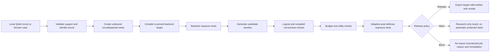

# Quantum Privacy Firewall: Product Requirements Document

**Version:** 1.0 draft, 30 October 2026  
**Product:** QPF Preflight  
**Primary track:** Quantum Security & Cryptography  
**Primary demonstration:** confidential defensive cryptanalysis  
**Second demonstration:** confidential portfolio-optimization research  
**Status:** proposed product behavior built on an existing QPF research prototype; this document does not assert that new features are implemented.

## 1. Product decision

QPF Preflight is a **local security review gate for quantum jobs**. Before a developer submits a Qiskit circuit to a cloud provider, QPF constructs the actual outbound view, tests what a defined observer could infer, searches for supported low-cost transformations, verifies that they preserve the intended computation, checks utility and resource cost, and issues an evidence-backed `RELEASE`, `WARN`, or `BLOCK` decision. It must never turn a classifier-confidence drop into an unqualified claim of confidentiality.

The flagship story is a communications-security research team preparing a Grover-based defensive cryptanalysis experiment. Their *oracle predicate* is sensitive. The second story is an investment research team preparing a QAOA portfolio experiment. Their *preference weights* are sensitive. Both use the same preflight framework but **not the same attack model or protection claim**.

The existing repo supplies the circuit-family baseline, rewriting, logical equivalence checks, budgeted candidate selection, and adaptive evaluation. The domain-specific oracle and preference tests, payload inspection, release policy, and general ingestion are **new requirements**. See the [research/evidence audit](QPF_CYBER_AND_PORTFOLIO_RESEARCH.md) for source links and limitations.

### One-line pitch

> QPF checks a quantum job for information leakage before cloud submission, proves supported rewrites preserve the computation, and refuses to release jobs whose sensitive intent remains exposed.

### Why now

[IBM Research's QCE 2026 study](https://research.ibm.com/publications/algorithmic-intent-leakage-in-transpiled-quantum-circuits-an-initial-reverse-engineering-study) demonstrates recoverable *coarse algorithmic intent* from final transpiled circuits under a defined experimental setup. QPF independently studies that question and adds an intervention loop. [IBM's Grover tutorial](https://quantum.cloud.ibm.com/docs/en/tutorials/grovers-algorithm), [Qiskit Grover examples](https://qiskit-community.github.io/qiskit-algorithms/tutorials/07_grover_examples.html), and [IBM's multi-objective portfolio tutorial](https://quantum.cloud.ibm.com/docs/en/tutorials/quantum-approximate-multi-objective-optimization) provide runnable, genuinely quantum workloads. They do not demonstrate that QPF protects those workloads; that is what the new product must test.

## 2. Problem, user, and outcome

### User problem

Quantum developers inspect source code locally, but the cloud service receives a backend-compatible circuit and often a parameter payload. That artifact can reveal workload family, algorithm-specific structure, numeric parameters, or the function of an oracle. A circuit that runs correctly can still disclose research intent. Conversely, a circuit that looks different may still disclose the same secret. Developers lack a focused, reproducible **pre-submission security and utility check** that distinguishes these cases.

### Primary users

| Persona | Job to be done | Sensitive fact | Desired decision |
|---|---|---|---|
| Communications-security researcher | Test a toy/reduced cryptanalytic condition using Grover and prepare a cloud job | Oracle predicate, marked state, or research target | Know whether the outbound circuit exposes the condition; block if it does |
| Quantum developer | Submit a Qiskit job without accidentally disclosing unsupported or explicitly exposed values | Workload family, parameters, comments, artifacts | Inspect an intelligible receipt and a valid export or a clear refusal |
| Investment research analyst | Compare candidate portfolios using QAOA while keeping a private risk/return preference local | Preference vector, possibly private coefficients in later versions | Detect visible values; use a safe alternative workflow if available |
| Security reviewer/judge | Audit why QPF said release or block | Evidence, controls, assumptions | Reproduce the decision and see residual risk rather than a green badge |

### User outcomes

1. A user can point QPF at a supported local circuit/workload and state **what fact is sensitive** and **who can see what**.
2. The report shows what the **original outbound job** exposes, not merely a score on the logical source circuit.
3. The user can compare verified candidate circuits against a chosen overhead budget and utility target.
4. The final decision cites the applicable attacker, verifier, support domain, and remaining uncertainty.
5. A blocked job is not exported as “protected.” The user sees a specific reason and possible next step.

## 3. Current baseline and release boundary

| Existing, measured | Evidence | Interpretation |
|---|---|---|
| Seven intent classes, 47 generators | [`paper_circuits.py`](../src/qpf/paper_circuits.py) | Controlled research corpus, not broad real-job coverage |
| 282 source circuits and 2,256 compiled records | [`paper_comparison.md`](../artifacts/paper_full/results/paper_comparison.md) | Five source-disjoint splits, FakeNighthawk, 24/48 qubits |
| Pooled family accuracy 0.956 +/- 0.007 | Same report | Strong family signal in this corpus; metadata-only 0.938 +/- 0.006 is a confound |
| 1,974 candidate rewrites logically verified | [`defense_summary.md`](../artifacts/paper_full/results/defense_summary.md) | Logical equivalence, not full payload privacy/noisy utility |
| Adaptive RF macro-F1 0.916 -> 0.878 at 20% budget | Same report | A modest reduction with high residual leakage; 95% paired delta CI +0.017 to +0.059 |
| Existing CLI, notebook, and bounded preset API | [`demo_attack.py`](../scripts/demo_attack.py), [`demo.ipynb`](../notebooks/demo.ipynb), [`schemas.py`](../backend/app/schemas.py) | The API accepts preset 4-8-qubit families, not arbitrary uploads |

**Product rule:** Any result from the existing family benchmark must be labeled `algorithm-family leakage on the controlled QPF corpus`. It is not an oracle-secret or finance-preference result. A single terminal attacker's confidence is an illustration, not aggregate security evidence.

## 4. Scope and priorities

### Release A: hackathon demonstration slice

The deliverable is a reproducible **local notebook/terminal demo** with two case studies and one common report format. A restored web frontend may visualize the same outputs, but it is not required for the core demonstration and must not show a different unsupported risk score. No live paid QPU account or network availability is required on stage.

**Must have:**

- Pinned, runnable Grover oracle case from public Qiskit examples or a clearly synthetic condition.
- Pinned, runnable 8-asset portfolio case using a subset of IBM's public 40-asset CSV; synthetic preference labels.
- An explicit outbound artifact view, at least `structural circuit` and `full job/payload` where applicable.
- Baseline family classifier shown only for its supported domain; secret-specific exact/trivial exposure checks for each case.
- Existing candidate rewrite, verification, budget, and adaptive-family result where supported.
- A shared receipt that displays `RELEASE/WARN/BLOCK`, proof status, overhead, utility and residual risk; unsupported checks produce `UNKNOWN`/block, not a false pass.
- Screenshots/plots produced from saved results with provenance and no hand-entered security improvements.

**Should have:** matched-shot output utility, bounded local QPY ingestion, preference fixed-sweep/local-selection comparator, and saved adaptive domain-specific evaluation.

**Could have after a stable release:** general QASM3 ingestion, second fake backend, noise models, compiled-layout equivalence, interactive frontend, faithful application-layer masking comparator, hardware run.

### Explicit non-goals for Release A

- Protecting actual network traffic, QKD keys, AES keys, or deployed bank assets.
- Claiming quantum advantage, real customer adoption, a known provider breach, or cryptographic secrecy from equivalent rewrites.
- Automatically uploading users' secret circuits to an external LLM/service for analysis.
- Executing uploaded Python or notebooks.
- A universal obfuscator, quantum homomorphic encryption, or blind quantum computing.
- An automated portfolio trading/recommendation product.

## 5. End-to-end product flow

The user's first screen/cell is **a working case selector**, not a marketing page. A local run offers `Cryptanalysis`, `Portfolio`, and `General circuit`; each view begins with a clearly labeled input, sensitive fact, observer, backend target, budget, and `Run preflight` command. The project should also support a noninteractive CLI for reproducibility and screenshot capture.

### Flow states

| State | Required behavior |
|---|---|
| `READY` | Validate input and expose the security assumptions before running |
| `COMPILING` | Show target backend/profile, seed, and unsupported operations |
| `ATTACKING_ORIGINAL` | Present the original-job view and the named attacker(s) |
| `SEARCHING` | Count generated, verified, rejected, and eligible candidates |
| `RETESTING` | Compare original and selected candidate using the same observer definition; adaptive models only where properly trained |
| `DECIDED` | Show verdict, evidence, residual risk, and export availability |
| `ERROR/UNKNOWN` | Explain the exact unsupported step; no silent fallback from verification failure to PASS |

### Observation contract

Every risk result must name one of these views:

1. **Structural circuit only:** backend-native gate sequence/structure and resource features, without source labels or secret parameter arrays. This is closest to the existing IBM/QPF intent study.
2. **Full job payload:** circuit plus numeric gate angles, runtime parameter bindings, shots and observable job metadata. It is the relevant view for a recipient of a portfolio PUB.
3. **Source/artifact access:** QPY/QASM, human-readable names, files, logs. This is largely out of the current ML attack scope and must be reported as a separate exposure class.

A result for one view cannot be displayed as protection against a stronger view. The interface should let a reviewer switch views and see which claims change.

## 6. Shared functional requirements

### EPIC 1: Input and provenance

| ID | User story | Acceptance criteria | Priority |
|---|---|---|---|
| IN-01 | As a researcher, I can select a named built-in case and rerun it. | Run records case ID, source version/hash, library versions, seed, backend and chosen budget; same inputs reproduce the artifact and metrics within stated stochastic tolerance. | Must |
| IN-02 | As a developer, I can pass a local `QuantumCircuit` without sending it elsewhere. | The preflight API analyzes it locally; no external network call is required; unsupported gates/measurements/parameters are identified before a security verdict. | Must |
| IN-03 | As a developer, I can import a bounded QPY or QASM3 circuit when supported. | Parser rejects oversized, malformed, dynamic/unsupported or ambiguous inputs with a named reason; no uploaded Python is executed; import round-trip tests preserve supported registers/measurements. | Should |
| IN-04 | As a reviewer, I know what the system analyzed. | Receipt includes sanitized input hash and provenance; secret predicate or private weights are not put in normal logs or exports. | Must |

### EPIC 2: Leakage inspection and threat model

| ID | User story | Acceptance criteria | Priority |
|---|---|---|---|
| LK-01 | As a user, I specify the protected fact and observer before seeing a security score. | Report names `family`, `oracle predicate/type`, or `portfolio preference` and the exact observation view; changing observer does not silently reuse an inapplicable score. | Must |
| LK-02 | As a reviewer, I can inspect what leaves the workstation. | A sanitized outbound summary lists width, depth, two-qubit gates, target, parameter count/binding presence, measurements, and job metadata. A privileged local detail view may inspect values, but the default receipt redacts secrets. | Must |
| LK-03 | As a user, I see a baseline risk assessment with its domain. | Family model reports model/feature version, training domain, support/abstention, predicted class, confidence, and aggregate evaluation; unsupported domain does not get a green risk score. | Must |
| LK-04 | As a researcher, I can compare weak and strong attackers. | Domain report identifies trivial/exact, metadata-only, structural and payload attackers where relevant; it reports chance/control baseline and held-out test protocol. | Should |

### EPIC 3: Candidate protection, correctness and utility

| ID | User story | Acceptance criteria | Priority |
|---|---|---|---|
| DF-01 | As a developer, I can set an overhead budget. | Only candidates passing verification and each configured cost bound are eligible; report shows actual depth/2Q/width deltas and why each rejected candidate failed. | Must |
| DF-02 | As a developer, I can see proof status. | Every candidate is `PASS`, `FAIL`, or `UNKNOWN` with method. Timeout, unsupported operation, missing checker, parameter ambiguity, or measurement-map uncertainty never becomes PASS. | Must |
| DF-03 | As a user, I can distinguish logical proof from hardware utility. | Report separately states logical equivalence, compiled/measurement validity if checked, exact output comparison, and noise/shot-based utility if run. Missing utility is `NOT EVALUATED`. | Must |
| DF-04 | As a reviewer, I can see whether defenses survive a realistic attacker. | Static and adaptive post-defense results are never conflated; adaptive result comes from properly separated protected training data. A single victim confidence is labeled illustrative. | Should |
| DF-05 | As a user, I can compare candidates. | Table and plot show baseline, chosen, and eligible candidates with proof, score, overhead, utility, and reason; selected item is clearly marked. | Must |

### EPIC 4: Policy and export

| ID | User story | Acceptance criteria | Priority |
|---|---|---|---|
| PL-01 | As a security reviewer, I can see why a job was released or blocked. | Policy lists each required gate (support, secret-exposure test, verification, budget, utility, model coverage), its status, and final verdict. No single confidence number decides release. | Must |
| PL-02 | As a developer, I cannot accidentally export a blocked job as “QPF-protected.” | The protected-export command refuses `BLOCK` and `UNKNOWN` decisions; if raw circuit export exists for development it is separately labeled unsafe and requires an explicit opt-in. | Must |
| PL-03 | As a developer, I can obtain an auditable receipt. | JSON plus human-readable report identify run ID, hashes, threat model, versions, tests, policy version, verdict, residual risk and timestamp without default secret disclosure. | Must |
| PL-04 | As a developer, I can inspect an actual target-ready artifact when released. | Export has a verified supported measurement mapping, target validity and pinned backend/version; any unverified assumptions are disclosed. | Should |

### EPIC 5: Demo and research reporting

| ID | User story | Acceptance criteria | Priority |
|---|---|---|---|
| RP-01 | As a judge, I can rerun both cases without paid access. | Documented setup and one command/notebook path use saved public inputs and local simulator/fake backend; a saved-results fallback has identical labels and provenance. | Must |
| RP-02 | As a judge, I can tell existing results from new results. | Figures and tables label corpus, sample count, backend, split method, attacker, confidence interval and date; no proposed metric appears as measured. | Must |
| RP-03 | As a presenter, I can show a compact technical narrative. | Run yields legible circuit snapshots, exposure comparison, candidate table, utility graphic and final decision, suitable for a 3-minute explanation without manual data edits. | Should |

## 7. Use case A: secure-communications cryptanalysis

### User journey

1. Researcher chooses `Cryptanalysis` and a synthetic Boolean/CNF security-test oracle, or supplies a supported local Grover circuit. The local UI explicitly labels this a **defensive research simulation**, not an attack on deployed encryption.
2. Researcher marks `oracle predicate` or `oracle type` as sensitive. QPF builds the complete outbound circuit and records the source predicate only locally for evaluation.
3. QPF compiles to the selected fake backend. It runs the existing family-recognition model only if in-domain, then separately tests whether the marked state/predicate can be recovered from the full circuit. A small-instance exact attacker is mandatory as a sanity check.
4. QPF tries supported rewrites and verifies computation/measurement behavior. It compares Grover success probability and depth/2Q cost before/after at matched shots.
5. QPF decides. If the oracle remains recoverable, it displays `BLOCK: oracle recoverable from outbound circuit` even if the family classifier confidence dropped. The user can inspect candidate evidence and the sanitized receipt.

### Domain-specific requirements

| ID | Requirement | Acceptance criteria | Priority |
|---|---|---|---|
| CY-01 | Public reproducible oracle inputs | At least one Boolean or DIMACS-CNF oracle follows a pinned Qiskit example; repository stores the synthetic instance/seed and version. | Must |
| CY-02 | Distinct levels of secrecy | Report separates Grover-family recognition, oracle-type classification, and exact marked-state/predicate recovery. It never labels a family score as predicate privacy. | Must |
| CY-03 | Small-instance exact recovery baseline | For a width within configured limit, evaluator probes/simulates the outbound oracle/circuit and reports recovered marked states or `INCONCLUSIVE`; the known synthetic truth is compared locally. | Must |
| CY-04 | Preserved utility | At equal ideal shots, original and rewritten cases report marked-state success, output distribution distance, and cost. Noisy simulation is explicitly labeled if used. | Must |
| CY-05 | Safe failure | If exact recovery succeeds, required proof is UNKNOWN, or no candidate meets budget/utility, protected export is blocked and reason is visible. | Must |
| CY-06 | Research-grade generalization | Multiple matched synthetic predicates; splits by predicate template, seed, and implementation; adaptive structural/gate-sequence attacker and uncertainty intervals. | Should |

**Success criterion:** the demo must correctly **detect and refuse** a deliberately exposed toy oracle while preserving an intelligible proof/utility report. A stronger protection claim is permitted only if a separately implemented method demonstrably reduces *predicate recovery* under the stated full-circuit attacker and preserves decoded correctness. There is no requirement to force a green release.

### Cyber-specific edge cases

- Multiple marked states: report the set or recovery overlap, not a single guessed key.
- Unknown/opaque oracle instruction: mark unsupported; do not assume QCEC can prove it.
- Mid-circuit measurement/feedback: unsupported in Release A unless specifically implemented.
- A rewrite has identical unitary yet exact attacker still recovers predicate: block; this is expected, not a verifier bug.
- Very large oracle: exact attack may be infeasible; report `NOT EVALUATED` rather than asserting secrecy.
- Uploaded circuit includes secret in a name/comment or parameter: source/artifact exposure warning, independent of structural attack.

### Cyber plots and metrics

- Before/after circuit thumbnail with consistent gate colors and backend target.
- Original versus protected *family prediction* and *predicate recovery* shown as separate columns.
- Marked-state heatmap or truth table (synthetic test only).
- Utility bars: ideal success probability, optional noise-model success, equal shots.
- Candidate frontier: residual exposure versus 2Q/depth overhead, colored by PASS/UNKNOWN/FAIL.

## 8. Use case B: bank/portfolio research

### User journey

1. Analyst chooses `Portfolio` and a pinned 8-asset subset of [IBM's public 40-asset market snapshot](https://raw.githubusercontent.com/Qiskit/documentation/main/datasets/tutorials/qmoo/market_data.csv). The notebook states the data is public; no real bank portfolio is implied.
2. Analyst chooses `risk-first`, `balanced`, or `return-first` synthetic preference. QPF builds the QAOA cost Hamiltonian/mixer using a reproducible version of [IBM's multi-objective workflow](https://quantum.cloud.ibm.com/docs/en/tutorials/quantum-approximate-multi-objective-optimization).
3. QPF shows two outbound views: structural circuit without numeric binding values and full job payload with values. It tests preference recovery in both. It must first check whether the weights are **directly present** in the bindings; an ML attack is not needed to call that exposure.
4. QPF checks rewrite equivalence where applicable and portfolio quality on the original objective, with feasibility `sum(x_i)=K`, risk, return, diversification, and cost.
5. If preference-bearing weights remain exposed, QPF blocks a `protected` export. If an implemented *fixed public sweep plus local private choice* is enabled, QPF compares outbound hashes across different private preferences and shows that the submitted job is unchanged while the locally selected portfolio changes.

### Domain-specific requirements

| ID | Requirement | Acceptance criteria | Priority |
|---|---|---|---|
| PF-01 | Public-data provenance | Dataset URL, pinned revision/hash, 8-asset selection rule, `K`, estimated return/covariance handling, and synthetic preference definition appear in the report. | Must |
| PF-02 | Correct workload construction | Bitstring maps to asset set; risk/return/diversification values agree with a classical evaluator for selected examples; valid outcomes contain exactly `K` assets or are explicitly post-selected. | Must |
| PF-03 | Separate observers | For identical parameterized structure with different bindings, structural-only and full-payload reports remain separate; direct parameter exposure triggers a full-payload finding. | Must |
| PF-04 | Preference attack protocol | Labels balanced within baskets; paired experiments vary only preference; held-out basket split, shuffled-label and parameter-only controls are reported if a generalization claim is made. | Should |
| PF-05 | Utility after rewrite | Compare same candidate portfolios against the **original** objective, at equal shots; report feasible fraction, selected-portfolio score, risk, return and diversification. Exact/classical or random comparator is labeled. | Must |
| PF-06 | Fixed public sweep option | If implemented, same public universe and configured sweep produce byte-identical outbound circuit/payload for two private preferences; local selection changes as expected and no private weights are serialized into the job/receipt. | Should |
| PF-07 | Scope warning | Report states that fixed sweep does not hide asset universe, public market data, Hamiltonian topology, or private covariance if those are sent. | Must |

**Success criterion:** the demo shows that QPF identifies the difference between *structural privacy* and *payload disclosure*, refuses a plainly exposed preference-bearing job, and, if implemented, validates a fixed-job/local-choice workflow. It makes no quantum-speedup claim; IBM's tutorial itself reports QAOA and random sampling as comparable in its 40-asset hardware demonstration.

### Portfolio-specific edge cases

- Analyst changes only preference but a cache/seed/batch order changes the job: fixed-sweep guarantee fails until normalized or disclosed.
- Dataset includes NaN, non-symmetric covariance, mismatched ticker order, or duplicate assets: reject before circuit construction.
- Parameterized gate cannot be safely rewritten: bind a supported kernel or skip rewrite with a visible reason; never cast symbolic parameters silently.
- No feasible sampled portfolio: show empty result and block a claim of preserved utility.
- One 8-asset circuit visits most/all 70 feasible portfolios: report exact enumeration and avoid implying quantum advantage.
- A private risk model is introduced: treat its coefficients as sensitive payload, not as protected by a public-weight sweep.

### Portfolio plots and metrics

- Bitstring-to-assets mapping and compact QAOA circuit slice.
- Three-objective Pareto scatter (risk, return, diversification) with selected portfolios marked.
- Structural-only versus full-payload preference recovery table/confusion matrix.
- Same-job hash comparison for fixed sweep; two private selections shown side by side.
- Feasibility, expected objective/regret, equal-shot sample count, depth/2Q overhead.

## 9. Release policy specification

The default policy is **fail closed for a protected export**. It does not ban a researcher from keeping the raw circuit locally; it prevents QPF from labeling a job protected when the evidence is insufficient.

| Gate | `PASS` | `FAIL`/`UNKNOWN` consequence |
|---|---|---|
| Supported input and observation schema | Parser/operations supported and observer defined | Block protected export; show unsupported reason |
| Secret-specific exposure test | Defined test under threshold or demonstrated absence of secret in outbound view | Block if exposed; unknown cannot become “secure” |
| Logical correctness | Supported proof PASS | Block on FAIL or UNKNOWN |
| Compiled/measurement correctness | Checked when the release contract requires it | Block or explicitly restrict release claim if unchecked |
| Hardware-resource budget | All configured limits met | Reject candidate; baseline may remain unprotected |
| Utility | Required minimum Grover/portfolio objective met | Reject candidate or mark not evaluated; no automatic green release |
| Model coverage | Attacker tested on supported domain; OOD disclosed | Abstain from numerical privacy verdict on OOD uploads |

`WARN` means an informational analysis is usable but there is not enough evidence for a protected export; it is **not** a softer word for RELEASE. Report a per-gate status table rather than hiding nuance behind a single risk percentage.

## 10. Scientific validation and quality bars

### Evaluation matrix

| Question | Primary measure | Controls/guardrails |
|---|---|---|
| Is algorithm family visible? | Accuracy, macro-F1, confusion matrix | Source-disjoint splits, metadata-only, held-out generators, chance/shuffled labels |
| Is the Grover oracle's fact visible? | Exact marked-state/predicate recovery or overlap; oracle-type accuracy separately | Matched width/depth/marked-count, held-out predicate templates, full-circuit observer |
| Is portfolio preference visible? | Direct binding exposure; balanced accuracy/weight error under full payload | Same public data across labels, held-out baskets, parameter-only and structural-only views |
| Did rewriting help? | Paired original/protected *adaptive* attack difference with CI | Retrain on protected data; avoid winner's curse and single-example headline |
| Is result correct? | QCEC/DAG/operator status plus measurement mapping; local decode for non-equivalent methods | Treat timeout/unsupported as UNKNOWN; never use privacy metric as correctness proof |
| Is it useful? | Grover marked-state success or portfolio objective/feasibility | Equal shots, exact/classical comparator, hardware-noise caveat |
| Is cost acceptable? | Depth, two-qubit gates, width, compilation/runtime | Same backend target and budget calculation for original/candidate |

### Gate-level acceptance tests

1. Every intentionally unsupported input produces a specific refusal and no protected export.
2. Every `FAIL`/`UNKNOWN` proof outcome fails the release gate.
3. A deliberately visible small Grover predicate is detected by an exact attacker and blocks, even if structural classifier confidence falls.
4. A portfolio preference explicitly present in PUB bindings is flagged by a direct-value test and blocks; a structural-only score cannot override it.
5. For a supported equivalent rewrite, the ideal output/decoded answer matches within an explicitly stated numerical tolerance; measurement mapping is checked.
6. Saved figures are regenerated from versioned result artifacts rather than manually edited values.
7. The existing family-benchmark numbers are unchanged by the new domain modules.

### Quantitative research targets, not promised results

- For baseline reproduction, match saved family metrics within a documented tolerance on pinned versions.
- For all released candidates, require 100% passing *required* correctness checks and 100% compliance with configured cost limits.
- For a claimed privacy improvement, require a positive paired effect under an adaptive attacker with confidence interval excluding zero **and** a remaining-risk disclosure. If not achieved, report no demonstrated improvement.
- For the fixed-sweep portfolio option, require exact equality of outbound job bytes/hashes across at least two private preferences under fixed public inputs and metadata; any change is a failed privacy-property test.
- Set per-case utility thresholds before evaluation (for example minimum marked-state success or maximum portfolio regret); record them in the run config. Do not tune them after seeing results.

## 11. Data, security, and privacy requirements

- Raw secret predicate and private preference values stay local to the run; normal receipts redact them. A debug/full-detail export is explicit and labeled sensitive.
- No arbitrary Python execution or unbounded parser work from uploaded files. QPY/QASM3 support must have byte-size, qubit, instruction, nesting/time and memory limits.
- Persist only sanitized hashes and aggregated metrics by default. If saving results, use an opt-in destination and disclose what is written.
- No network call is required for core demo or risk scoring. The 40-asset public CSV is pinned/cached so judges can run offline.
- Model artifacts are versioned and loaded from trusted local sources; no untrusted pickle upload.
- A provider's TLS/IAM security is complementary. QPF does not claim other tenants can view jobs or that QPF substitutes for cloud access control.

## 12. UX, report, and accessibility requirements

The primary surface is a clear notebook/CLI sequence, with optional frontend reading the same saved JSON. Each case has four compact sections: `Job and secret`, `What an observer sees`, `Candidates and proof`, and `Decision`. Comparisons use consistent original/protected colors, labelled axes, units, legends, and visible uncertainty; color is never the only status cue. Circuits show readable cropped sections with a link/export to the complete diagram. Large job/candidate lists are tables, not nested decorative cards. A blocked case must be as presentable as a released case: reason, evidence, and next action at the top.

### Minimum report fields

`run_id`, `case`, `timestamp`, `source_hash`, `data_hash`, `secret_type`, `observer_view`, `backend`, `optimization_level`, `seed`, `model/feature versions`, `baseline_attack`, `selected_attack`, `attacker_domain`, `verification status/method`, `budget`, `actual costs`, `utility`, `policy gates`, `verdict`, `limitations`, and `citations/provenance`.

### Required visual artifacts for presentation

1. One-page architecture/decision-flow diagram.
2. Grover original-versus-compiled circuit figure and exact recovery/decision panel.
3. Candidate tradeoff plot with proof/budget overlay and a utility chart.
4. Portfolio structural-versus-payload comparison and Pareto plot.
5. A legible sanitized receipt, plus the existing aggregate research table with all caveats.

## 13. Dependencies, risks, and mitigations

| Risk | Consequence | Product response |
|---|---|---|
| Equivalent rewrites cannot hide a function from a full-circuit observer | Oracle secrecy claim fails | Make exact attacker mandatory and demonstrate an honest BLOCK; keyed/encoded method is separately scoped |
| Parameter bindings expose preference directly | Structural-only classifier gives false comfort | Inspect the full PUB payload and use trivial-value baseline before ML |
| Existing rewrite code loses classical register/mis-handles symbols | Invalid real-world circuits | Support bounded bound unitary kernels first; preserve/re-attach measurements, reject unsupported forms |
| Generator signatures and metadata confound classifier | Inflated leakage/generalization claims | Metadata-only, shuffled, group-held-out and OOD controls |
| Formal equivalence is mistaken for utility | Noisy output degrades | Equal-shot ideal/noise tests and separate utility gate |
| Portfolio tutorial uses public data and shows no speedup | Misleading real-world claim | Call it a reproducible **research workflow**, not a bank deployment or quantum advantage |
| Too much functionality for a one-day sprint | No stable demo | Prioritize notebook/CLI vertical slice and saved offline outputs; defer general uploader and frontend |
| Live cloud dependency fails during pitch | Demonstration fails | Use pinned fake backend/local simulator and a recorded result artifact as fallback |

## 14. Phased delivery and exit criteria

### Phase 0: freeze the existing evidence

Pin environment, snapshot saved reports, run focused existing tests, and record known limitations. **Exit:** old demo/benchmark artifacts still load, claims sheet distinguishes measured/proposed, no user worktree changes are overwritten.

### Phase 1: common preflight spine

Add a supported local `QuantumCircuit` path, observer/secret declaration, outbound job summary, receipt schema and fail-closed policy. **Exit:** a general toy circuit can be analyzed locally and produces an evidence table; unsupported operation blocks protected export.

### Phase 2: cyber flagship

Add one public/synthetic Grover oracle, exact recovery baseline, measurement-aware correctness, budget/utility and decision. **Exit:** a known exposed predicate is recovered and blocked; candidate evidence is screenshot-ready and reproducible offline.

### Phase 3: portfolio second vertical

Add pinned 8-asset public-data QAOA, synthetic preferences, full-PUB exposure check, classical objective validation, and optional fixed sweep/local choice. **Exit:** preference exposure is correctly flagged; if fixed sweep exists, job equality and local-choice difference are machine-checked.

### Phase 4: research-strengthening

Add balanced domain datasets, adaptive secret-specific models, grouped held-out splits, second backend, noise utility and a faithful prior-art comparator. **Exit:** aggregate claims have uncertainty intervals and controls; negative findings remain visible.

## 15. Demo script and judge questions

**Opening (15 seconds):** “This is cybersecurity *for the quantum program*. A cloud quantum job is executable research, and its circuit or parameters can reveal what the developer is working on.”

**Cyber reveal (60 seconds):** Show a small synthetic Grover oracle. QPF inspects the compiled outbound job, compares family prediction with exact oracle recovery, generates and verifies candidate rewrites, and **blocks** if the sensitive predicate remains visible. Explain why QCEC proves computation preservation, not secrecy.

**Portfolio reveal (45 seconds):** Show a public-data QAOA job under two private preferences. Structural circuit versus full parameter payload give different exposure answers. Show the blocked unsafe payload or, if implemented, identical fixed-sweep job hashes and different local selections.

**Research proof (45 seconds):** Show 282-source/2,256-record saved benchmark, metadata control, adaptive 0.916-to-0.878 result and CI, then the new case-specific tests. Label old versus new experiments.

**Close (15 seconds):** “QPF is a quantum pre-submission gate: test what leaks, preserve what computes, and decline what cannot be defended.”

**Likely judge questions and correct answers:**

| Question | Answer |
|---|---|
| “Can another cloud customer see my job?” | We do not claim that. Our observer is explicitly someone with access to the job artifact/payload, such as a provider-side role, compromised credential or shared artifact recipient. |
| “Does QCEC prove privacy?” | No; it proves supported functional equivalence. Privacy is tested against the named attacker. |
| “If the oracle is unchanged, how can it be hidden?” | It often cannot from a full-circuit observer. QPF must catch that and block; keyed/application-level privacy would be a separate method. |
| “Does this protect BB84 or break AES?” | No. The demo uses toy defensive cryptanalysis; neither statement follows. |
| “Where is the real-world finance data?” | Public market snapshot in IBM's tutorial; the confidential preferences are synthetic. We do not claim an actual bank customer. |
| “Is this the first quantum circuit obfuscator?” | No. [Enigma](https://arxiv.org/abs/2311.13546), [SPYCE](https://arxiv.org/abs/2307.16799) and [OPAQUE](https://arxiv.org/abs/2502.16605) are prior work. QPF's target contribution is the integrated, attacker-tested preflight decision. |

## 16. Open decisions

1. Is Release A a **research-only** gate with no `RELEASE` for secret-bearing cases, or should a limited safe-export path be part of the judged demo? Default recommendation: research-only/blocked for the two secret-bearing cases unless the full policy is truly met.
2. What exact Grover secret is protected in the flagship: marked string, Boolean formula class, or private protocol property? Default: marked string for exact small-instance demonstration, formula class as a second label; do not imply real cipher key protection.
3. What does the portfolio fixed sweep hold constant: market universe, shots, parameter batch ordering, job metadata, backend, and timestamps? Define this before claiming job invariance.
4. Does the frontend display only saved notebook/CLI results, or is it a live analyzer? Default: saved artifact viewer until it can use the same backend/model and policy.
5. Which utility threshold is acceptable for each case? Set pre-run in config and show it in the receipt.

## 17. References and related local documents

The [use-case research brief](QPF_CYBER_AND_PORTFOLIO_RESEARCH.md) contains the full primary-source ledger and code audit. The [earlier strategy note](QPF_HACKATHON_RESEARCH_STRATEGY.md) covers the broader gateway idea and portfolio-only planning. Key external anchors are [IBM's intent-leakage study](https://research.ibm.com/publications/algorithmic-intent-leakage-in-transpiled-quantum-circuits-an-initial-reverse-engineering-study), [IBM's Grover tutorial](https://quantum.cloud.ibm.com/docs/en/tutorials/grovers-algorithm), [IBM's portfolio QAOA tutorial](https://quantum.cloud.ibm.com/docs/en/tutorials/quantum-approximate-multi-objective-optimization), [Qiskit primitive inputs](https://quantum.cloud.ibm.com/docs/en/guides/primitive-input-output), [MQT QCEC](https://mqt.readthedocs.io/projects/qcec/en/stable/), and [Q-Hack India judging criteria](https://www.quantumweek.tech/hackathon).
